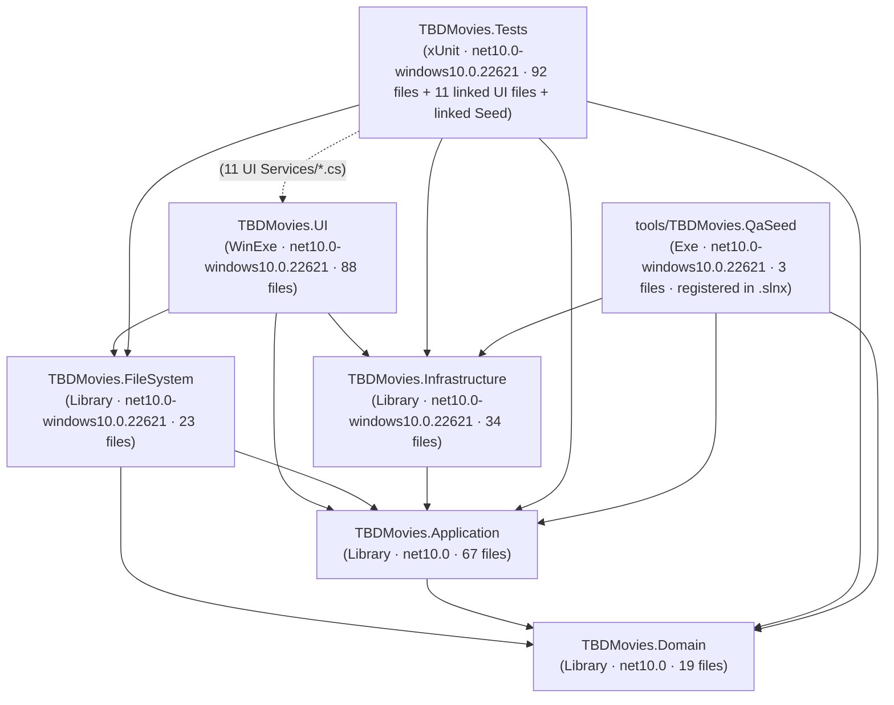

# TBD Movies — Consolidated Elephant Architecture & Contract Reference (`EGM.md`)

> **Snapshot Provenance**: Reconstructed `2026-11-17` Working State (`v0.12.5`, SQLite Schema `v23`, `1,143` automated test cases across `87` test classes in `86` test files, `333` non-documentation project files) built atop GitHub `main` (`afcb3c8a`) + `TBD_Movies_Transfer_Package.zip` (`06_Git_Patch_and_State/uncommitted_changes.patch` + `08_New_Untracked_Source_Files/`).
> **Structure Policy (`Option B`)**: Single consolidated root `EGM.md` covering all root manifests and solution projects under `TBDMovies_WinUI3/` (`src/`, `tests/`, `tools/`, `packaging/`). Unless prefixed with repository root `/`, all project-relative paths (`src/...`, `tests/...`, `tools/...`, `packaging/...`, `TBDMovies.slnx`, `global.json`) resolve under `TBDMovies_WinUI3/`. Zero `EGM.md` files exist inside source subdirectories, keeping `README.md` dedicated to public overview documentation.

---

## 1. System Overview, Clean Architecture & Build Topology

**TBD Movies** (`TBD-Movies.exe`, Product `"TBD Movies"`, `Version = 0.12.5`) is a local-first Windows 10/11 desktop media library manager built on **C# / .NET 10 (`10.0.400`)** and **WinUI 3 (`Microsoft.WindowsAppSDK 1.7.260224002`)** with **SQLite (`Microsoft.Data.Sqlite 10.0.11`)** in WAL mode. It manages local movie and multi-season TV episode collections with journaled crash-safe filesystem organization (`hardlink-unlink` and verified `copy-verify-delete`), offline-capable TMDB metadata enrichment and poster caching, bilingual English/Arabic (RTL) UI, external media player timeline tracking, local/SubDL subtitle discovery & normalization, and optional Trakt OAuth device-code sync, scrobbling, and custom list reconciliation.

### 1.1 Clean Architecture Dependency Graph

### 1.2 Solution Projects, Target Frameworks & NuGet Dependency Matrix

Pinned SDK in `TBDMovies_WinUI3/global.json`: **`.NET SDK 10.0.400`** (`rollForward: "latestPatch"`, `allowPrerelease: false`).

| Project | `.slnx`? | Output | Target Framework | Project References | Direct NuGet Packages | File Count |
|---|:---:|---|---|---|---|---:|
| `src/TBDMovies.Domain` | Yes | `Library` | `net10.0` | None | None | `19` |
| `src/TBDMovies.Application` | Yes | `Library` | `net10.0` | `Domain` | None | `67` |
| `src/TBDMovies.FileSystem` | Yes | `Library` | `net10.0-windows10.0.22621` | `Domain`, `Application` | None | `23` |
| `src/TBDMovies.Infrastructure` | Yes | `Library` | `net10.0-windows10.0.22621` | `Application` *(transitive `Domain`)* | `Microsoft.Data.Sqlite` (`10.0.11`), `System.Security.Cryptography.ProtectedData` (`10.0.14`) | `34` |
| `src/TBDMovies.UI` | Yes | `WinExe` | `net10.0-windows10.0.22621` (`Min=10.0.17763.0`) | `Application`, `Infrastructure`, `FileSystem` | `Microsoft.WindowsAppSDK` (`1.7.260224002`), `Microsoft.Windows.SDK.BuildTools` (`10.0.26100.9169`), `CommunityToolkit.Mvvm` (`8.4.0` — *unused*), `Microsoft.Extensions.DependencyInjection` (`10.0.11` — *unused*) | `88` |
| `tests/TBDMovies.Tests` | Yes | `Library` (Test) | `net10.0-windows10.0.22621` | `Domain`, `Application`, `Infrastructure`, `FileSystem` + 11 `<Compile Include>` UI files + linked `Seed.cs` | `Microsoft.NET.Test.Sdk` (`17.14.1`), `xunit` (`2.9.3`), `xunit.runner.visualstudio` (`3.1.5`) | `92` |
| `tools/TBDMovies.QaSeed` | **Yes** | `Exe` | `net10.0-windows10.0.22621` | `Infrastructure`, `Application`, `Domain` | None *(inherits `Sqlite` & `ProtectedData`)* | `3` |
| `packaging/` + Root Meta | N/A | Inno Setup / Meta | Windows x64 (`Inno Setup 6`) | Packages Release `win-x64` build output of `TBDMovies.UI` | None | `3 + 5` |

---

## 2. Global System Invariants, Safety Protocols & Boundaries

### 2.1 Local-First Media & Filesystem Safety Invariants
1. **Strict Separation of Scan, Match, Import, and Filesystem Mutation**:
   - `MediaDiscoveryService.Discover`, `ImportService.PreviewMetadataAsync`, and `TvLibraryService.GetShowDetailsEnrichedAsync` are read-only operations: scanning or matching metadata NEVER registers catalog rows and NEVER renames or moves files on disk.
   - `LibraryRepairService.RemoveMovieFromLibrary`, `RemoveShowFromLibrary`, and `LibraryMaintenanceRepository.ClearCatalog` (`MaintenanceRepository.cs:7, 16`) delete SQLite rows ONLY and NEVER delete user video files on disk (`IUiActions.cs:28-43, 211`).
2. **Journaled Two-Phase File Transfer (`FileOperationCoordinator` + `SafeTransferEngine`)**:
   - Every move/rename transitions through SQLite `file_operations` states: `PLANNED -> VALIDATED -> EXECUTING -> FS_VERIFIED -> COMMITTED` (or `FAILED` / `RECOVERY_REQUIRED` on interruption) (`FileOperationCoordinator.cs:33-114`).
   - `PathPolicy` (`PathPolicy.cs:15-200`) enforces explicit `approvedRoots`, `Path.IsPathFullyQualified`, zero `FileAttributes.ReparsePoint` components on any ancestor, zero NTFS Alternate Data Streams (`:`), and zero DOS device names (`CON`, `PRN`, `AUX`, `NUL`, `COM1..9`, `LPT1..9`).
   - `WindowsNative` (`WindowsNative.cs:88-135`) locks source files with `OpenLockedSource` (`GenericRead | Delete`, `FileShareRead` only) and destination parent directories with `OpenDirectoryGuard` (no `FILE_SHARE_DELETE`), verifying `(Size, MTimeNs, VolumeSerialNumber, FileIndex)` before and after transfer. Same-volume moves use `CreateHardLinkW` (`hardlink-unlink`); cross-volume moves stream to `.{dest}.tbdmovies-{opId}.tmp`, flush to disk, rename atomically, verify SHA-256 via `CryptographicOperations.FixedTimeEquals`, and remove source via `MarkDeleteOnClose` (`SafeTransferEngine.cs:45-153`). `[M3]` disposes handles first on failure and cleans orphaned hardlinks/temp files (`SafeTransferEngine.cs:85-114`).
3. **Fail-Closed Storage & Network Share Guard (`AvailabilityInspector` + `NetworkReadGuard`)**:
   - Disconnected drives (`!DriveInfo.IsReady`) or unreachable UNC shares (`\\server\share`) return `AvailabilityInspectionStatus.StorageUnavailable` (`AvailabilityInspector.cs:41-77`) and MUST NEVER mark registered `media_files` as `MISSING` or prune them (`ReconciliationService.cs:76-93`).
   - `NetworkReadGuard` (`NetworkReadGuard.cs:20-80`) bounds UNC share metadata probes to a default `2s` timeout (polled in `<= 50ms` slices).

### 2.2 SQLite Concurrency, Process Ownership & Backup Invariants
1. **Cross-Process Single-Owner Lock (`LibraryInstanceGuard` + `App.xaml.cs` `[L9]`)**:
   - `LibraryInstanceGuard.TryAcquire` (`LibraryInstanceGuard.cs:24-58`) holds an exclusive OS `FileStream` (`FileShare.None`) on `{library.db}.tbdmovies-lock` for the entire process lifetime (`AppServices.cs:540-585`, acquired at `L575`, released last in `Shutdown()` at `L714`).
   - Before constructing `MainWindow`, `App.OnLaunched` (`App.xaml.cs:26-53, 70-278`) checks `TryClaimSingleInstance()`; on contention, it locates same-session, exact-executable-path sibling processes, foregrounds visible HWNDs (`SW_RESTORE` only if `IsIconic`), or terminates headless zombie instances (`1s` grace poll if uptime `< 10s`).
2. **In-Process Write Serialization (`DatabaseWriteGate`) & Connection Pragmas (`SqliteConnections`)**:
   - `DatabaseWriteGate.Enter(connectionString)` (`DatabaseWriteGate.cs:26-31`) serializes writers per normalized DB path via a non-reentrant `SemaphoreSlim(1, 1)`.
   - `SqliteConnections.Open` (`SqliteConnections.cs:7-23`) configures every connection with `foreign_keys = ON`, `journal_mode = WAL`, `synchronous = NORMAL` (`[P4]`), `busy_timeout = 10000`, `cache_size = -64000` (~64 MB), `mmap_size = 268435456` (256 MB), and `temp_store = MEMORY`.
   - `DatabaseBootstrap.ReleasePooledConnections()` (`DatabaseBootstrap.cs:37`) clears `SqliteConnection` pools during `AppServices.Shutdown()` (`AppServices.cs:709`) so WAL checkpoints cleanly on exit.
3. **Fail-Closed Pre-Mutation Backups (`DatabaseSafetyBackup`)**:
   - Before forward schema migrations (`currentVersion > 0 && currentVersion < targetVersion`, `DatabaseMigrator.cs:776-781`) and `ClearCatalog()` (`MaintenanceRepository.cs:24-28`), `DatabaseSafetyBackup.CreateVerifiedBackup` (`DatabaseSafetyBackup.cs:41-90`) snapshots `library.db` via SQLite's online `BackupDatabase` API into `backups/library.{timestamp}.v{ver}.{label}.{token}.db`, verifies `PRAGMA integrity_check == "ok"` and `PRAGMA user_version`, and retains `RetentionCount = 5` newest backups (deferred until post-commit on migrations, `DatabaseMigrator.cs:823-824`).

### 2.3 UI Threading, Lifecycle, Startup & Bilingual RTL Invariants
1. **Startup & Transitions (`[P3]`, `[P5]`)**:
   - `MainWindow` (`MainWindow.xaml.cs:52-56, 124-241`) runs `RestorePreferencesFast()` before `InitializeComponent()`, displays `StartupSplashOverlay` immediately while `Task.Run(AppServices.Initialize)` runs in background, enforces `MinSplashDwellMs = 700` when animations are enabled, fades out splash over `200ms CubicEaseOut`, and plays `150ms` (`Opacity 0->1`, `TranslateY 15->0`) entrance transitions (`PlayPageTransition`, `L724-816`).
2. **Cached View Lifecycle (`IActivatableView`, `IDeactivatableView`, `ILocalizableView`)**:
   - `MainWindow` hosts `_homePage` eagerly and 9 lazy pages permanently in `ContentHost.Children`, switching via `Visibility` (`MainWindow.xaml.cs:245-260, 654-718`). Because `Unloaded` does not fire on tab switches, views must gate background continuations via `_isActivated` / `PostHandoffRequestLifetime` and cancel timers/CTSs inside `Deactivate()`.
3. **Bilingual EN/AR & Western Digits Invariant (`LocalizationService`)**:
   - `LocalizationService` (`LocalizationService.cs:13-1660`) defines `733` English (`L15-770`) and `733` Arabic (`L772-1529`) dictionary entries resolving to `729` unique keys per language (with `4` overwritten duplicate keys), switches `RootGrid.FlowDirection` (`RightToLeft` for Arabic, while keeping `TitleBarDragRegion` `LeftToRight` at `MainWindow.xaml:58`), uses `"Segoe UI"` for Arabic + `LineStackingStrategy="MaxHeight"` (`Styles.xaml:44, 49, 54`), and formats all numbers via `LocalizationService.Digits(...)`, folding Indic digits to ASCII `0..9` inside Unicode LRE (`U+202A..U+202C`).

### 2.4 Security, Credential Vault, Trakt Sync & Clean-Room Legal Boundaries
1. **Windows Credential Manager & QA Profile Isolation (`[M2]`, `[L7]`)**:
   - TMDB (`WindowsTmdbCredentialStore`, target `"TBDMovies/TMDB"`) and Trakt (`WindowsTraktCredentialStore`, target `"TBDMovies/Trakt"`) persist secrets via Win32 `Advapi32.dll` (`CredWriteW`, `CredReadW`, `CredDeleteW`), zeroing unmanaged/managed buffers via `CryptographicOperations.ZeroMemory`, with write-read roundtrip verification inside `WindowsTraktCredentialStore.Write` (`L164-169`) and caller-layer `_credentialStore.Read()` verification for TMDB (`SettingsService.cs:152, 164, 234`).
   - When `TBDMOVIES_TEST_DATA_ROOT` (`AppServices.cs:73-93`) is set to a fully qualified path, data and credentials isolate to `{TBDMOVIES_TEST_DATA_ROOT}` and Vault targets `"TBDMovies/{TMDB|Trakt}/QA/{64-char-uppercase-hex-sha256}"` (`Convert.ToHexString(SHA256.HashData(...))` over normalized `.ToUpperInvariant()` profile path in `WindowsTmdbCredentialStore.cs:31-36`, `WindowsTraktCredentialStore.cs:36-41`).
2. **Trakt Zero Ghost Media & `userListsSuccess` Deletion Safeguard**:
   - Downstream watched sync (`TraktSyncService.cs:1356-1472`) updates watch state ONLY for movies/shows already present in the local SQLite catalog (`Zero Ghost Media` in `movies`/`tv_shows`); cloud-only items exist strictly inside `custom_list_members` (`movie_id IS NULL AND show_id IS NULL AND tmdb_id > 0`).
   - Downstream deletion of locally linked custom lists (`ReconcileCustomListsAsync`, `TraktSyncService.cs:1666-1686`) executes ONLY when `userListsSuccess == true` (live network fetch of `TraktCacheResourceKeys.Lists` (`users/me/lists`) succeeded at `L432-470`; per-list item fetches track `itemSuccess` separately at `L485-513`).
3. **GPL-3.0 Clean-Room Provenance Rule (`AGENTS.md:115`, `BUGS.md:530-531`)**:
   - `TBD Movies` is licensed under `GPL-3.0` (`LICENSE:1-2`). Studying reference open-source projects (such as `Seanime` or `Habari`) alongside official Microsoft WinRT/Win32 and player specifications is permitted to understand protocol flows, provided all implementations are clean-room native code conforming strictly to `TBD Movies` layer contracts without blind copy-pasting.

---

## 3. Complete SQLite Schema Contract (`LatestVersion = 23`)

Managed by `TBDMovies.Infrastructure.Persistence.Migrations.DatabaseMigrator` (`DatabaseMigrator.cs:7-1024`).

### 3.1 Schema Version Evolution (`v1` – `v23`)

| Version | Script Name / Milestone (`DatabaseMigrator.cs`) | Structural Changes |
|---:|---|---|
| `v1` | `0001_initial` (`L19-106`) | Creates `movies`, `media_files`, `metadata_cache`, `file_operations`, `watched_folders`, `settings` + 2 `file_operations` indexes |
| `v2` | `0002_portable_filesystem_identity` (`L107-159`) | Rebuilds `file_operations` so `source_dev`, `source_ino`, `destination_dev`, `destination_ino` are `TEXT` (64-bit unsigned portability) |
| `v3` | `0003_movie_catalog` (`L160-164`) | Adds `movies.genres TEXT NOT NULL DEFAULT '[]'`; creates `idx_media_files_movie_id` |
| `v4` | `0004_personal_library_foundation` (`L165-187`) | Creates `movie_personal_state` and initial movie-only `watch_events` + 3 indexes |
| `v5` | `0005_offline_movie_registration` (`L188-238`) | Rebuilds `movies` (`foreign_keys=OFF`): nullable `provider`/`external_id`, adds `metadata_status` + provider/READY `CHECK`s |
| `v6` | `0006_tv_hierarchy` (`L239-327`) | Creates `tv_shows`, `tv_seasons`, `tv_episodes`, `episode_media_files` + 4 indexes |
| `v7` | `0007_media_details_enrichment` (`L328-344`) | Adds `backdrop_path`/`tagline` (`movies`, `tv_shows`), `rating` (`tv_shows`, `tv_episodes`), `poster_path`/`air_date`/`external_id` (`tv_seasons`), `still_path`/`external_id` (`tv_episodes`) |
| `v8` | `0008_durable_watch_history` (`L345-379`) | Rebuilds `watch_events` (`foreign_keys=OFF`) for polymorphic `MOVIE`/`EPISODE` with `ON DELETE SET NULL` and title/artwork snapshots |
| `v9` | `0009_reconcile_watch_events_artwork_columns` (`L380-423`) | Rebuilds `watch_events` (`foreign_keys=OFF`, `GetMigrationScript` dynamic projection) to heal historical v8 drift missing `backdrop_reference`/`poster_reference` |
| `v10` | `0010_tv_show_import_aliases` (`L424-444`) | Creates `tv_show_aliases` + `idx_tv_show_aliases_show_id`; backfills `sort_title` from `tv_shows` |
| `v11` | `0011_custom_list_membership` (`L445-460`) | Creates transitional `custom_list_movies` (dropped in `v12`) |
| `v12` | `0012_custom_list_definitions` (`L461-522`) | Creates `custom_lists` and `custom_list_members`; migrates `'ui_custom_lists'` JSON settings & `'thrillers'` slot; drops `custom_list_movies` |
| `v13` | `0013_custom_list_mixed_media` (`L523-560`) | Rebuilds `custom_list_members` for `MOVIE` + `SHOW` with partial unique indexes `ux_custom_list_members_movie` & `ux_custom_list_members_show` |
| `v14` | `v14` (`L561-566`) | Adds `movies.review_match INTEGER NOT NULL DEFAULT 0` |
| `v15` | `v15` (`L567-572`) | Adds `last_opened_at TEXT NULL` to `movies` and `tv_shows` |
| `v16` | `v16` (`L573-597`) | Creates `active_viewings` + `ux_active_viewings_movie`, `ux_active_viewings_episode`, `idx_active_viewings_started` |
| `v17` | `v17` (`L598-609`) | Creates `tv_show_personal_state` + favorite/watch_later indexes |
| `v18` | `v18` (`L610-626`) | Creates `trakt_resource_cache` (`json_valid` check) + `idx_trakt_resource_cache_account` |
| `v19` | `v19` (`L627-631`) | Adds `custom_display_title TEXT NULL` to `movies` and `tv_shows` |
| `v20` | `v20` (`L632-638`) | Creates scale/sorting indexes `idx_movies_date_added`, `idx_movies_last_opened`, `idx_movies_title`, `idx_tv_shows_date_added` |
| `v21` | `v21` (`L639-648`) | Creates `playback_progress` + `idx_playback_progress_watched` |
| `v22` | `v22` (`L649-714`) | Adds Trakt columns to `custom_lists` (`trakt_list_id`, `trakt_slug`, `sync_status`, `is_deleted`, `last_synced_at`); rebuilds `custom_list_members` (`foreign_keys=OFF`) for cloud items (`tmdb_id`, `cloud_title`, `cloud_year`) + `ux_custom_list_members_tmdb`; creates `custom_list_pending_actions` |
| `v23` | `0023_relax_custom_list_pending_actions_for_create_list` (`L716-734`) | Rebuilds `custom_list_pending_actions` (`foreign_keys=OFF`) allowing nullable `media_kind`/`tmdb_id` and `action_type IN ('ADD', 'REMOVE', 'CREATE_LIST')` |

### 3.2 Complete 20-Table Schema Specification (`v23`)

1. **`movies`** (`v1`, rebuilt `v5`, altered `v3, v7, v14, v15, v19`)
   - **Columns**: `id INTEGER PK`, `provider TEXT NULL`, `external_id TEXT NULL`, `title TEXT NOT NULL`, `original_title TEXT NULL`, `year INTEGER NULL`, `overview TEXT NULL`, `runtime_minutes INTEGER NULL`, `rating REAL NULL`, `poster_path TEXT NULL`, `date_added TEXT NOT NULL`, `created_at TEXT NOT NULL`, `updated_at TEXT NOT NULL`, `genres TEXT NOT NULL DEFAULT '[]'`, `metadata_status TEXT NOT NULL DEFAULT 'PENDING'`, `backdrop_path TEXT NULL`, `tagline TEXT NULL`, `review_match INTEGER NOT NULL DEFAULT 0`, `last_opened_at TEXT NULL`, `custom_display_title TEXT NULL`.
   - **Constraints**: `CHECK(metadata_status IN ('PENDING','READY','FAILED','NEEDS_MATCH'))`; `CHECK((provider IS NULL AND external_id IS NULL) OR (provider IS NOT NULL AND external_id IS NOT NULL AND length(trim(provider)) > 0 AND length(trim(external_id)) > 0))`; `CHECK(metadata_status != 'READY' OR (provider IS NOT NULL AND external_id IS NOT NULL))`; `UNIQUE(provider, external_id)`.
   - **Indexes**: `idx_movies_date_added(date_added DESC, id DESC)`, `idx_movies_last_opened(last_opened_at DESC, id DESC)`, `idx_movies_title(title COLLATE NOCASE)`.

2. **`media_files`** (`v1`, indexed `v3`)
   - **Columns**: `id INTEGER PK`, `movie_id INTEGER NULL REFERENCES movies(id) ON DELETE SET NULL`, `current_path TEXT NOT NULL`, `path_key TEXT NOT NULL UNIQUE`, `file_size INTEGER NOT NULL CHECK(file_size >= 0)`, `extension TEXT NULL`, `resolution TEXT NULL`, `codec TEXT NULL`, `source TEXT NULL`, `status TEXT NOT NULL DEFAULT 'PRESENT' CHECK(status IN ('PRESENT','MISSING'))`, `discovered_at TEXT NOT NULL`, `last_seen_at TEXT NOT NULL`.
   - **Indexes**: `idx_media_files_movie_id(movie_id)`.

3. **`metadata_cache`** (`v1` — *unreferenced in `src/` except `ClearCatalog()`*)
   - **Columns**: `id INTEGER PK`, `provider TEXT NOT NULL`, `cache_key TEXT NOT NULL`, `payload TEXT NOT NULL`, `fetched_at TEXT NOT NULL`, `expires_at TEXT NULL`.
   - **Constraints**: `UNIQUE(provider, cache_key)`.

4. **`file_operations`** (`v1`, rebuilt `v2`)
   - **Columns**: `id TEXT PK`, `operation_type TEXT NOT NULL CHECK(operation_type IN ('MOVE','RENAME'))`, `source_path TEXT NOT NULL`, `destination_path TEXT NOT NULL`, `state TEXT NOT NULL CHECK(state IN ('PLANNED','VALIDATED','EXECUTING','FS_VERIFIED','COMMITTED','FAILED','RECOVERY_REQUIRED'))`, `media_file_id INTEGER NULL REFERENCES media_files(id) ON DELETE SET NULL`, `reverses_operation_id TEXT NULL REFERENCES file_operations(id) ON DELETE SET NULL`, `source_size INTEGER`, `source_mtime_ns INTEGER`, `source_dev TEXT`, `source_ino TEXT`, `destination_size INTEGER`, `destination_mtime_ns INTEGER`, `destination_dev TEXT`, `destination_ino TEXT`, `destination_sha256 TEXT`, `strategy TEXT`, `error_code TEXT`, `error_message TEXT`, `created_at TEXT NOT NULL`, `updated_at TEXT NOT NULL`.
   - **Indexes**: `idx_file_operations_state(state)`, `idx_file_operations_media_file_id(media_file_id)`.

5. **`watched_folders`** (`v1` — *dead table; folders stored in `settings['ui_media_folders']`*)
   - **Columns**: `id INTEGER PK`, `path TEXT NOT NULL COLLATE NOCASE UNIQUE`, `folder_role TEXT NOT NULL CHECK(folder_role IN ('MOVIES','SCAN'))`, `enabled INTEGER NOT NULL DEFAULT 1 CHECK(enabled IN (0,1))`, `created_at TEXT NOT NULL`.

6. **`settings`** (`v1`)
   - **Columns**: `key TEXT PK`, `value TEXT NOT NULL`, `updated_at TEXT NOT NULL`.

7. **`movie_personal_state`** (`v4`)
   - **Columns**: `movie_id INTEGER PK REFERENCES movies(id) ON DELETE CASCADE`, `preference TEXT NOT NULL DEFAULT 'NO_OPINION' CHECK(preference IN ('NO_OPINION','LIKED','BLACKLISTED'))`, `watchlist_added_at TEXT NULL`, `created_at TEXT NOT NULL`, `updated_at TEXT NOT NULL`.
   - **Indexes**: `idx_movie_personal_state_preference(preference)`, `idx_movie_personal_state_watchlist(watchlist_added_at)`.

8. **`watch_events`** (`v4`, rebuilt `v8, v9`)
   - **Columns**: `id INTEGER PK`, `media_kind TEXT NOT NULL CHECK(media_kind IN ('MOVIE','EPISODE'))`, `movie_id INTEGER NULL REFERENCES movies(id) ON DELETE SET NULL`, `episode_id INTEGER NULL REFERENCES tv_episodes(id) ON DELETE SET NULL`, `watched_at TEXT NOT NULL`, `created_at TEXT NOT NULL`, `title_snapshot TEXT NOT NULL`, `year_snapshot INTEGER NULL`, `show_title_snapshot TEXT NULL`, `season_number_snapshot INTEGER NULL`, `episode_number_snapshot INTEGER NULL`, `artwork_reference TEXT NULL`, `backdrop_reference TEXT NULL`, `poster_reference TEXT NULL`.
   - **Constraints**: `CHECK((media_kind = 'MOVIE' AND episode_id IS NULL) OR (media_kind = 'EPISODE' AND movie_id IS NULL))`.
   - **Indexes**: `idx_watch_events_movie_watched(movie_id, julianday(watched_at), id)`, `idx_watch_events_episode_watched(episode_id, julianday(watched_at), id)`, `idx_watch_events_recent(julianday(watched_at) DESC, id DESC)`.

9. **`tv_shows`** (`v6`, altered `v7, v15, v19`, indexed `v20`)
   - **Columns**: `id INTEGER PK`, `provider TEXT NULL`, `external_id TEXT NULL`, `title TEXT NOT NULL`, `sort_title TEXT NOT NULL`, `original_title TEXT NULL`, `year INTEGER NULL`, `overview TEXT NULL`, `genres TEXT NOT NULL DEFAULT '[]'`, `poster_path TEXT NULL`, `metadata_status TEXT NOT NULL DEFAULT 'PENDING'`, `date_added TEXT NOT NULL`, `created_at TEXT NOT NULL`, `updated_at TEXT NOT NULL`, `backdrop_path TEXT NULL`, `rating REAL NULL`, `tagline TEXT NULL`, `last_opened_at TEXT NULL`, `custom_display_title TEXT NULL`.
   - **Constraints**: `CHECK(metadata_status IN ('PENDING','READY','FAILED','NEEDS_MATCH'))`, `CHECK(length(trim(title)) > 0)`, `CHECK(length(trim(sort_title)) > 0)`, `CHECK(year IS NULL OR (year >= 1 AND year <= 9999))`, provider pair & `READY` `CHECK`s, `UNIQUE(provider, external_id)`.
   - **Indexes**: `UNIQUE idx_tv_shows_sort_title(sort_title)`, `idx_tv_shows_date_added(date_added DESC, id DESC)`.

10. **`tv_seasons`** (`v6`, altered `v7`)
    - **Columns**: `id INTEGER PK`, `show_id INTEGER NOT NULL REFERENCES tv_shows(id) ON DELETE CASCADE`, `season_number INTEGER NOT NULL CHECK(season_number >= 0 AND season_number <= 999)`, `title TEXT NULL`, `overview TEXT NULL`, `created_at TEXT NOT NULL`, `updated_at TEXT NOT NULL`, `poster_path TEXT NULL`, `air_date TEXT NULL`, `external_id TEXT NULL`.
    - **Constraints & Indexes**: `UNIQUE(show_id, season_number)`, `idx_tv_seasons_show_id(show_id)`.

11. **`tv_episodes`** (`v6`, altered `v7`)
    - **Columns**: `id INTEGER PK`, `season_id INTEGER NOT NULL REFERENCES tv_seasons(id) ON DELETE CASCADE`, `episode_number INTEGER NOT NULL CHECK(episode_number >= 0 AND episode_number <= 999)`, `title TEXT NULL`, `overview TEXT NULL`, `runtime_minutes INTEGER NULL CHECK(runtime_minutes IS NULL OR runtime_minutes > 0)`, `air_date TEXT NULL`, `created_at TEXT NOT NULL`, `updated_at TEXT NOT NULL`, `still_path TEXT NULL`, `rating REAL NULL`, `external_id TEXT NULL`.
    - **Constraints & Indexes**: `UNIQUE(season_id, episode_number)`, `idx_tv_episodes_season_id(season_id)`.

12. **`episode_media_files`** (`v6`)
    - **Columns**: `media_file_id INTEGER PK REFERENCES media_files(id) ON DELETE CASCADE`, `episode_id INTEGER NOT NULL REFERENCES tv_episodes(id) ON DELETE CASCADE`, `linked_at TEXT NOT NULL`.
    - **Indexes**: `idx_episode_media_files_episode_id(episode_id)`.

13. **`tv_show_aliases`** (`v10`)
    - **Columns**: `id INTEGER PK`, `show_id INTEGER NOT NULL REFERENCES tv_shows(id) ON DELETE CASCADE`, `alias_sort_title TEXT NOT NULL UNIQUE`, `created_at TEXT NOT NULL`.
    - **Indexes**: `idx_tv_show_aliases_show_id(show_id)`.

14. **`custom_lists`** (`v12`, altered `v22`)
    - **Columns**: `id INTEGER PK`, `display_name TEXT NOT NULL CHECK(length(trim(display_name)) > 0)`, `created_at TEXT NOT NULL`, `trakt_list_id INTEGER DEFAULT NULL`, `trakt_slug TEXT DEFAULT NULL`, `sync_status TEXT NOT NULL DEFAULT 'SYNCED'`, `is_deleted INTEGER NOT NULL DEFAULT 0`, `last_synced_at TEXT DEFAULT NULL`.
    - **Indexes**: `idx_custom_lists_created(created_at, id)`, `idx_custom_lists_trakt(trakt_list_id)`.

15. **`custom_list_members`** (`v12`, rebuilt `v13, v22`)
    - **Columns**: `id INTEGER PK`, `list_id INTEGER NOT NULL REFERENCES custom_lists(id) ON DELETE CASCADE`, `media_kind TEXT NOT NULL CHECK(media_kind IN ('MOVIE','SHOW'))`, `tmdb_id INTEGER DEFAULT NULL`, `movie_id INTEGER NULL REFERENCES movies(id) ON DELETE CASCADE`, `show_id INTEGER NULL REFERENCES tv_shows(id) ON DELETE CASCADE`, `cloud_title TEXT NULL`, `cloud_year INTEGER NULL`, `added_at TEXT NOT NULL`.
    - **Constraints**: `CHECK((media_kind IN ('MOVIE','SHOW')) AND ((media_kind = 'MOVIE' AND movie_id IS NOT NULL AND show_id IS NULL) OR (media_kind = 'SHOW' AND show_id IS NOT NULL AND movie_id IS NULL) OR (movie_id IS NULL AND show_id IS NULL AND tmdb_id IS NOT NULL AND tmdb_id > 0)))`.
    - **Indexes**: `idx_custom_list_members_list(list_id)`, `idx_custom_list_members_movie(movie_id)`, `idx_custom_list_members_show(show_id)`, `UNIQUE ux_custom_list_members_movie(list_id, movie_id) WHERE movie_id IS NOT NULL`, `UNIQUE ux_custom_list_members_show(list_id, show_id) WHERE show_id IS NOT NULL`, `UNIQUE ux_custom_list_members_tmdb(list_id, media_kind, tmdb_id) WHERE tmdb_id IS NOT NULL`.

16. **`active_viewings`** (`v16`)
    - **Columns**: `id INTEGER PK`, `media_kind TEXT NOT NULL CHECK(media_kind IN ('MOVIE','EPISODE'))`, `movie_id INTEGER NULL REFERENCES movies(id) ON DELETE CASCADE`, `episode_id INTEGER NULL REFERENCES tv_episodes(id) ON DELETE CASCADE`, `media_file_id INTEGER NULL REFERENCES media_files(id) ON DELETE SET NULL`, `title_snapshot TEXT NOT NULL`, `year_snapshot INTEGER NULL`, `season_number_snapshot INTEGER NULL`, `episode_number_snapshot INTEGER NULL`, `episode_title_snapshot TEXT NULL`, `path TEXT NOT NULL`, `started_at TEXT NOT NULL`, `artwork_reference TEXT NULL`, `backdrop_reference TEXT NULL`, `poster_reference TEXT NULL`.
    - **Constraints & Indexes**: `CHECK((media_kind = 'MOVIE' AND movie_id IS NOT NULL AND episode_id IS NULL) OR (media_kind = 'EPISODE' AND episode_id IS NOT NULL AND movie_id IS NULL))`; `UNIQUE ux_active_viewings_movie(movie_id) WHERE movie_id IS NOT NULL`, `UNIQUE ux_active_viewings_episode(episode_id) WHERE episode_id IS NOT NULL`, `idx_active_viewings_started(julianday(started_at) DESC, id DESC)`.

17. **`tv_show_personal_state`** (`v17`)
    - **Columns**: `show_id INTEGER PK REFERENCES tv_shows(id) ON DELETE CASCADE`, `is_favorite INTEGER NOT NULL DEFAULT 0 CHECK(is_favorite IN (0,1))`, `watch_later_added_at TEXT NULL`, `created_at TEXT NOT NULL`, `updated_at TEXT NOT NULL`.
    - **Indexes**: `idx_tv_show_personal_state_favorite(is_favorite)`, `idx_tv_show_personal_state_watch_later(watch_later_added_at)`.

18. **`trakt_resource_cache`** (`v18`)
    - **Columns**: `account_id TEXT NOT NULL`, `resource_key TEXT NOT NULL`, `payload_json TEXT NULL`, `succeeded_at TEXT NULL`, `attempted_at TEXT NOT NULL`, `error_code TEXT NULL`, `PRIMARY KEY(account_id, resource_key)`.
    - **Constraints & Indexes**: `CHECK(length(trim(account_id)) > 0)`, `CHECK(length(trim(resource_key)) > 0)`, `CHECK(length(trim(attempted_at)) > 0)`, `CHECK(payload_json IS NULL OR json_valid(payload_json) = 1)`; `idx_trakt_resource_cache_account(account_id)`.

19. **`playback_progress`** (`v21`)
    - **Columns**: `media_file_id INTEGER PK REFERENCES media_files(id) ON DELETE CASCADE`, `position_seconds REAL NOT NULL CHECK(position_seconds >= 0)`, `total_duration_seconds REAL NULL CHECK(total_duration_seconds IS NULL OR total_duration_seconds > 0)`, `last_watched_at TEXT NOT NULL`.
    - **Indexes**: `idx_playback_progress_watched(julianday(last_watched_at) DESC)`.

20. **`custom_list_pending_actions`** (`v22`, rebuilt `v23`)
    - **Columns**: `id INTEGER PRIMARY KEY AUTOINCREMENT`, `list_id INTEGER NOT NULL REFERENCES custom_lists(id) ON DELETE CASCADE`, `media_kind TEXT NULL CHECK(media_kind IS NULL OR media_kind IN ('MOVIE','SHOW'))`, `tmdb_id INTEGER NULL CHECK(tmdb_id IS NULL OR tmdb_id > 0)`, `action_type TEXT NOT NULL CHECK(action_type IN ('ADD','REMOVE','CREATE_LIST'))`, `created_at TEXT NOT NULL`.
    - **Indexes**: `idx_pending_actions_list(list_id)`.

---

## 4. Component & File-by-File Contracts (`333` Non-Documentation Files)

### 4.1 Root & Solution Meta Files (`5` Files)

| File Path | Lines | Contract, Invariants & Dependencies |
|---|---:|---|
| `.gitignore` | `62` | Root Git ignore policy blocking `*.db`, `*.db-wal`, `*.db-shm`, `*.sqlite*`, `.env*`, `poster-cache/`, `*.zip`, `artifacts/`, `portable/`, and `ALL_IDEAS_ROADMAP.md`. |
| `LICENSE` | `621` | Verbatim GNU General Public License v3.0 (`29 June 2007`). Zero custom riders. |
| `TBDMovies_WinUI3/.gitignore` | `35` | Solution-scoped ignore rules excluding `bin/`, `obj/`, `.vs/`, `publish/`, `AppPackages/`, `*.msix*`, `*.pri`, `*.g.cs`, `TestResults/`, `*.trx`. |
| `TBDMovies_WinUI3/TBDMovies.slnx` | `15` | XML solution manifest registering the 5 `src/*` projects, `tests/TBDMovies.Tests`, and `tools/TBDMovies.QaSeed`. |
| `TBDMovies_WinUI3/global.json` | `7` | Pins `.NET SDK 10.0.400` (`rollForward: "latestPatch"`, `allowPrerelease: false`). |

---

### 4.2 `TBDMovies_WinUI3/src/TBDMovies.Domain/` (`19` Files)

**Layer Contract**: Pure `net10.0` domain value objects, enums, invariants, and deterministic scoring algorithms. Zero NuGet packages, zero project references, zero disk/DB/network/Win32 I/O.

1. **`TBDMovies.Domain/TBDMovies.Domain.csproj`** (`10` lines) — `Microsoft.NET.Sdk`, `TargetFramework=net10.0`, `Nullable=enable`, zero external dependencies.
2. **`TBDMovies.Domain/DomainAssemblyMarker.cs`** (`10` lines) — `public static class DomainAssemblyMarker { public static string AssemblyName { get; } }` *(unreferenced marker)*.
3. **`TBDMovies.Domain/Configuration/Models.cs`** (`15` lines) — `public enum UiLanguage { English, Arabic }`; `public enum UiTheme { Main, Dark, Slate, Light }`.
4. **`TBDMovies.Domain/Core/Operations/Models.cs`** (`125` lines) — Journaled file operation domain types: `OperationType { Move, Rename }`, `OperationState { Planned, Validated, Executing, FsVerified, Committed, Failed, RecoveryRequired }`, `RecoverySituation`, `FileOperationPlan` (enforces trimmed `operationId`, `Path.IsPathFullyQualified` normalized `source`/`destination`, `mediaFileId > 0`), `OperationUpdate`, `FileOperationRecord`, `PreparedTransfer`, `RecoveryInspection`, `StaleTempFileInfo`.
5. **`TBDMovies.Domain/Core/Safety/Models.cs`** (`18` lines) — `public sealed record SourceIdentity(long size, long mTimeNs, ulong dev, ulong ino)` enforcing `size >= 0`.
6. **`TBDMovies.Domain/Library/Availability/Models.cs`** (`28` lines) — `AvailabilityInspectionStatus { Present, Missing, StorageUnavailable, Error }` (forbidding missing-file transitions on `StorageUnavailable`), `MediaFileIdentity(Size, MTimeNs, CTimeNs, Dev, Ino)`, `AvailabilityInspection`.
7. **`TBDMovies.Domain/Library/Movies/Models.cs`** (`275` lines) — `MediaFileStatus { Present, Missing }`, `MetadataStatus { Pending, Ready, Failed, NeedsMatch }`, `MediaFileStatusUpdate`, `MovieCatalogData` (enforces paired `(provider == null) == (externalId == null)`, `Ready => provider != null`, non-blank `title`, null-or-trimmed optional strings, `year in [1..9999]`, `runtimeMinutes > 0`, `rating in [0..10]`), `Movie` (`id > 0`, `DisplayTitle => CustomDisplayTitle ?? Title`), `VerifiedMediaFileFacts`, `MediaFile` (`Path.IsPathRooted`, `fileSize >= 0`, `extension` starting with `'.'`).
8. **`TBDMovies.Domain/Library/Operations/Models.cs`** (`31` lines) — `OperationJournalSnapshot` *(unreferenced in `src/`/`tests/`)*.
9. **`TBDMovies.Domain/Library/Personal/Models.cs`** (`214` lines) — `PersonalPreference { NoOpinion, Liked, Blacklisted }`, `PersonalLibrarySection { Watchlist, ReadyToWatch, Liked, Blacklisted }`, `PersonalMovieState` (`(watchCount > 0) == (lastWatched != null)`), `WatchEvent`, `WatchHistoryEntry` (mutually exclusive `movieId`/`episodeId`), `WatchEventMediaKind`, `ReadyToWatchMovie`, `PersonalMovieSummary`, `CustomListRecord`, `CustomListMediaKind { Movie, Show }`, `CustomListPendingAction`, `CustomListMember` (`IsCloudOnly`).
10. **`TBDMovies.Domain/Library/Shows/SeasonModels.cs`** (`207` lines) — `TvSeason` and `TvEpisode` domain entities + `ValidateSeasonNumber`/`ValidateEpisodeNumber` (`[0..999]`, `0` = Specials; `runtimeMinutes > 0`; `rating in [0..10]`).
11. **`TBDMovies.Domain/Library/Shows/ShowModels.cs`** (`264` lines) — `EpisodeAvailability { NoFile, Present, Missing }`, `TvShowCatalogData` (`NormalizeTitle(title)` lowercase alphanumeric `SortTitle` with `Length > 0`, paired provider/externalId, `year in [1..9999]`, `rating in [0..10]`), `TvShow` (`DisplayTitle => CustomDisplayTitle ?? Title`).
12. **`TBDMovies.Domain/Media/DetectedSubtitle.cs`** (`13` lines) — `DetectedSubtitle(FilePath, FileName, Extension, LanguageCode, LanguageName, IsForced, IsSdh)`.
13. **`TBDMovies.Domain/Media/Discovery/Models.cs`** (`125` lines) — `DiscoveryClassification { MovieCandidate, TvEpisodeCandidate, TvEpisodeSkipped, TvEpisodeUnsupported, UnknownMedia, Error }`, `DiscoveryErrorCode`, `DiscoveryProgress`, `DiscoveryIssue`, `FileObservation`, `DiscoveredMedia` (enforces error/non-error field exclusivity and `TvEpisodeCandidate` non-null `SeasonNumber`/`EpisodeNumber`/`Title`).
14. **`TBDMovies.Domain/Media/Matcher/MetadataScorer.cs`** (`453` lines) — Deterministic title+year matching engine (`AutoMatchThreshold = 0.80`, `BulkAcceptThreshold = 0.75`, `AmbiguityScoreThreshold = 0.65`, `AmbiguityScoreDelta = 0.15`, `ReviewThreshold = 0.50`). `NormalizeTitle` folds Unicode FormD diacritics, tatweel, Arabic alef/ya/teh-marbuta, and Indic digits; `CalculateTitleSimilarity` averages Jaccard word overlap and Levenshtein ratio (`75%` title weight + year delta `+0.25 / +0.10 / -0.30`); `IsCorroboratedSoleCandidate` validates strict prefix + year/part-marker corroboration. Verified by `MetadataScorerTests.cs` (`35` cases).
15. **`TBDMovies.Domain/Media/Matcher/Models.cs`** (`151` lines) — `MatchStatus { Matched, ReviewRequired, NoMatch }`, `MatchReason`, `CandidateScore`, `MatchDecision`, `TvCandidateScore`, `TvMatchDecision` (enforcing `[0..1]` finite scores and candidate-nullability invariants).
16. **`TBDMovies.Domain/Media/MediaFormatPolicy.cs`** (`52` lines) — Approved video extension allowlist `{ ".mkv", ".mp4", ".avi", ".mov", ".m4v", ".wmv" }` (`IsSupportedVideoExtension`, `IsSupportedVideoPath`).
17. **`TBDMovies.Domain/Media/Parser/Models.cs`** (`70` lines) — `MediaType { Movie, TvEpisode, Unknown }`, `ParsedMedia` (enforces `[0..999]` season/episode numbers and paired presence on `TvEpisode`).
18. **`TBDMovies.Domain/Metadata/Contracts/Models.cs`** (`139` lines) — Provider-agnostic metadata records: `MovieSearchQuery`, `MovieCandidate`, `MovieMetadata`, `TvSearchQuery`, `TvCandidate`, `TvShowMetadata`, `TvSeasonMetadata`, `TvEpisodeMetadata`.
19. **`TBDMovies.Domain/Playback/PlaybackModels.cs`** (`40` lines) — `MediaPlayerType { Default, Vlc, Mpc, Mpv, Custom }` and `PlaybackProgress(MediaFileId, PositionSeconds, TotalDurationSeconds, LastWatchedAt)` (`ProgressPercentage` clamped `[0..100]`, `HasResumePosition => PositionSeconds >= 3.0 && (TotalDurationSeconds is null || ProgressPercentage < 92.0)`, `FormatTime`).

---

### 4.3 `TBDMovies_WinUI3/src/TBDMovies.Application/` (`67` Files)

**Layer Contract**: `net10.0` use-case orchestration, UI-facing service contracts, repository/external provider abstractions, playback tracking, subtitle contracts, and Trakt OAuth/projection/2-way sync engine. References `TBDMovies.Domain` only (`TBDMovies.Application.csproj:11`; exposes internals to `TBDMovies.Tests` at `TraktSyncService.cs:10`).

#### 4.3.1 Core Application Files (`42` Files)

1. **`TBDMovies.Application/TBDMovies.Application.csproj`** (`14` lines) — `Microsoft.NET.Sdk`, `TargetFramework=net10.0`, `ProjectReference` -> `TBDMovies.Domain`.
2. **`TBDMovies.Application/ApplicationAssemblyMarker.cs`** (`10` lines) — `ApplicationAssemblyMarker.AssemblyName` *(unreferenced marker)*.
3. **`TBDMovies.Application/CustomListExceptions.cs`** (`19` lines) — `DuplicateCustomListNameException(string name)` thrown on case-insensitive trimmed custom-list name collision.
4. **`TBDMovies.Application/Contracts/IUiActions.cs`** (`264` lines) — 10 UI-facing service interfaces: `ILibraryUiActions`, `ILibraryRepairUiActions` (catalog-only removal/move), `IPersonalLibraryUiActions` (preferences, watchlist, watch events, custom lists + cloud member removal), `IWatchHistoryUiActions`, `IImportUiActions`, `ITvLibraryUiActions`, `ISettingsUiActions`, `IOrganizationUiActions`, `IOperationHistoryUiActions`, `IReconciliationUiActions`.
5. **`TBDMovies.Application/Dto/CatalogDtos.cs`** (`187` lines) — Movie/Import/Personal DTOs: `MovieListItem`, `CustomList`, `CustomListItem` (`IsCloudOnly`), `MovieDetails`, `MovieFileIngestionResult`, `MoveToSeriesResult`, `ConfirmMovieImportCommand`, `ImportReviewProgress`, `ImportReviewSession`, `ImportItemStatus` enum, `ImportMetadataPreview`, `ImportSelection`, `ImportProgress`, `ImportItemResult`, `ImportBatchResult`, `ManualMovieSearchResult`, `ClearLibraryDataResult`, `PersonalMovieSnapshot`, `WatchHistoryItem`.
6. **`TBDMovies.Application/Dto/OperationDtos.cs`** (`57` lines) — `OrganizationPreview`, `OrganizationResult`, `OperationHistoryQuery`, `OperationHistoryItem`, `OperationDetails`, `UndoPreview`, `UndoResult`, `RecoveryAssessment`, `RecoveryResult`, `LibraryReconciliationProgress`, `RelinkPreview`, `RelinkResult`, `LibraryHealthProgress`, `MetadataHealthStatus`, `MetadataHealthIssue`, `MetadataProviderError`, `MetadataHealthItem`.
7. **`TBDMovies.Application/Dto/ShowPersonalDtos.cs`** (`7` lines) — `ShowPersonalSnapshot(int ShowId, bool IsFavorite, bool WatchLater)`.
8. **`TBDMovies.Application/Dto/TvBatchDtos.cs`** (`274` lines) — `TvEvidenceSource`, `TvBatchWarningCode`, `TvBatchWarning`, `TvBatchFileCandidate` (`WithCorrection` enforcing `[0..999]` bounds, blocking `TvEpisodeUnsupported`/`Error`, requiring explicit 3-tuple acknowledgment to clear `FolderConflict`/`AmbiguousPathProvenance`), `TvEpisodeCandidate`, `TvSeasonCandidate`, `TvSeriesCandidate`, `TvBatchAnalysisResult`.
9. **`TBDMovies.Application/Dto/TvDtos.cs`** (`128` lines) — `TvShowListItem`, `TvContinueWatchingItem`, `TvShowDetails`, `TvSeasonDetails`, `TvEpisodeDetails`, `EpisodeFileIngestionResult`, `ConfirmEpisodeImportCommand`, `EpisodeRegistrationRefusal` enum, `EpisodeRegistrationException`.
10. **`TBDMovies.Application/Dto/ViewingDtos.cs`** (`19` lines) — `ActiveViewingItem` DTO.
11. **`TBDMovies.Application/External/IExternalServices.cs`** (`99` lines) — External port contracts: `ConnectionTestResult`, `IMetadataProvider`, `PosterRequest`, `PosterAsset`, `IPosterService`, `IPosterCacheMaintenance`, `IFileOperationCoordinator` (requiring explicit `approvedRoots`), `IAvailabilityInspector` (fail-closed `IsStorageAvailable`), `IMediaDiscoveryService`.
12. **`TBDMovies.Application/External/IImportFileValidator.cs`** (`9` lines) — `IImportFileValidator.Validate(DiscoveredMedia, CancellationToken)`.
13. **`TBDMovies.Application/External/MetadataServiceException.cs`** (`27` lines) — `MetadataFailureKind` enum and `MetadataServiceException(MetadataFailureKind)` (redacted message invariant: carries enum kind only, never URLs or tokens).
14. **`TBDMovies.Application/External/TmdbCredentials.cs`** (`17` lines) — `ITmdbCredentialStore`, `ITmdbCredentialValidator`, `TmdbCredentialState`, `TmdbCredentialFailure`, `TmdbCredentialResult`.
15. **`TBDMovies.Application/Metadata/TmdbUrl.cs`** (`88` lines) — `TmdbUrlKind { Movie, Tv }` and `TmdbUrl.TryParse(string?, out TmdbUrlKind, out string)` (`[L3]`: upgrades bare domains to `https://`, rejects `http://` and non-`(www.)themoviedb.org` hosts, parses `/movie/{id}` or `/tv/{id}`).
16. **`TBDMovies.Application/Playback/IPlayerProcessLauncher.cs`** (`20` lines) — `IPlayerProcessLauncher.LaunchAndTrackAsync(...)` abstraction over external player process & timeline polling.
17. **`TBDMovies.Application/Playback/PlaybackTrackingService.cs`** (`293` lines) — `PlaybackMediaTarget` and `PlaybackTrackingService`: dual-query resume (`GetByMediaFileId` -> `GetForMovie`/`GetForEpisode`), player preference settings (`playback_player_*`), periodic tick persistence (`!isPaused && MediaFileId > 0`), `>= 92%` end-credits progress deletion, `>= 90%` local watch-history auto-recording, and asymmetric Trakt scrobbling (`Start` on launch; `Stop` if `>= 90%` else `Pause` `[U2]`), plus `PlaybackEnded` event.
18. **`TBDMovies.Application/Repositories/IPlaybackProgressRepository.cs`** (`17` lines) — `IPlaybackProgressRepository` CRUD/batch read contract over `playback_progress`.
19. **`TBDMovies.Application/Repositories/IRepositories.cs`** (`229` lines) — Core persistence contracts: `IMovieRepository`, `IMediaFileRepository`, `IFileOperationStore`, `IPersonalLibraryRepository` (including Trakt custom-list sync & pending-action DIMs), `IWatchHistoryRepository`, `IViewingActivityRepository`, `ILibraryMaintenanceRepository`, `ISettingsRepository`, `ICatalogUnitOfWork` (with `Savepoint`/`ReleaseSavepoint`/`RollbackToSavepoint`), `ICatalogUnitOfWorkFactory`.
20. **`TBDMovies.Application/Repositories/IShowPersonalRepository.cs`** (`14` lines) — `IShowPersonalRepository` (`GetState`, `SetFavorite`, `SetWatchLater`, `ListShowIds`).
21. **`TBDMovies.Application/Repositories/ITvRepositories.cs`** (`137` lines) — `ITvShowSummaryReader`, `ITvContinueWatchingReader`, `TvShowSummary`, `ITvShowRepository` (including immutable import alias methods `GetByAlias`/`RegisterAlias`), `ITvSeasonRepository`, `ITvEpisodeRepository` (1-to-1 file ownership).
22. **`TBDMovies.Application/Services/ImportService.cs`** (`1337` lines) — Implements `IImportUiActions`: `BatchSize = 500` UoW chunking with per-item SQLite savepoints (`sp_{i}`), local-first registration before TMDB enrichment, canonical path cross-ownership guards, `ShouldBulkAccept` (`Matched` or `ReviewRequired >= 0.75`) + movie-only `SoleCredibleFallback` (`ReviewMatch = true`), duplicate TMDB movie edition merging (`TryAssociateWithExistingMovie`), and TV show alias resolution. Verified by `ImportSelectedTests.cs` (`60` cases) & `SmartTvImportSafetyTests.cs` (`17` cases).
23. **`TBDMovies.Application/Services/LibraryRepairService.cs`** (`118` lines) — Implements `ILibraryRepairUiActions`: `MoveMovieToSeries`, `RemoveShowFromLibrary`, `RemoveMovieFromLibrary` (blocks removal during nonterminal `file_operations`; never deletes disk files).
24. **`TBDMovies.Application/Services/LibraryService.cs`** (`194` lines) — Implements `ILibraryUiActions` + `IPersonalLibraryUiActions`: O(1) bulk movie list hydration (`ListMovieIdsWithPresentFile`, `CountFilesByMovie`, `ListWatchedMovieIds`), custom display titles, personal states, watch events, and custom lists.
25. **`TBDMovies.Application/Services/MetadataMatchingService.cs`** (`690` lines) — Bounded TMDB candidate search (`MaxSearchQueries = 3`), optimistic concurrency stale-request guard (`MetadataFailureKind.StaleRequest`), external-ID collision guard (`IdentityConflict`), TV season/episode sync (wiping stale metadata on show rematch), and fire-and-forget `EnsurePosterCachedAsync`.
26. **`TBDMovies.Application/Services/MovieOrganizationNaming.cs`** (`37` lines) — Pure `Title (Year)` filename generator (`HasTrustworthyMetadata`, `SuggestBaseName` stripping invalid chars, DOS device names, and capping `<= 255` chars).
27. **`TBDMovies.Application/Services/OperationHistoryService.cs`** (`164` lines) — Implements `IOperationHistoryUiActions`: journal history listing, UTF-8 plain-text export (`File.WriteAllText`), and one-shot undo/recovery orchestration over `IFileOperationCoordinator`.
28. **`TBDMovies.Application/Services/OrganizationService.cs`** (`100` lines) — Implements `IOrganizationUiActions` + `OrganizationDestinationConflictException`: validates destination root/filename invariants, issues one-shot preview tokens, re-verifies TOCTOU source identity, and executes via `IFileOperationCoordinator`.
29. **`TBDMovies.Application/Services/ReconciliationService.cs`** (`326` lines) — Implements `IReconciliationUiActions`: per-root `IsStorageAvailable` probing (local roots before UNC roots, preserving offline drives), `BatchSize = 500` status updates, `PruneDeadMissingFiles`, exact-byte-size `Missing` file relinking, and `CheckLibrary`.
30. **`TBDMovies.Application/Services/SettingsService.cs`** (`300` lines) — Implements `ISettingsUiActions`: `[L7]` TMDB credential priority (`ITmdbCredentialStore` > legacy `tmdb_read_access_token` migration > env var unless `tmdb_explicitly_removed`), Printable-ASCII `[20..2048]` token sanitization, live validation + rollback on save failure, serialized `ClearLibraryData()`, and UI theme/language persistence.
31. **`TBDMovies.Application/Services/ShowPersonalLibraryService.cs`** (`47` lines) — TV show `Liked` / `Watchlist` state service over `IShowPersonalRepository` and `ITvLibraryUiActions`.
32. **`TBDMovies.Application/Services/TitleInteractionController.cs`** (`331` lines) — `IClipboardService`, `ITimerToken`, `IInteractionTimerScheduler`, `IDoubleClickTimeProvider`, `WindowsDoubleClickTimeProvider` (`user32.dll!GetDoubleClickTime`), `TaskDelayScheduler`, and `TitleInteractionController` (`[U4]` generation-fenced single-click copy vs double-click/F2 inline edit up to `MaxTitleLength = 500`).
33. **`TBDMovies.Application/Services/TvBatchAnalysisService.cs`** (`700` lines) — `ITvBatchAnalysisService` and pure `TvBatchAnalysisService`: root-bounded folder/filename evidence extraction (`Season N` / `الموسم N` / `Specials`, bare numeric episodes excluding `480/576/720/1080/2160`), multi-folder series unification (`AmbiguousPathProvenance`), and duplicate episode detection (`DuplicateEpisodePosition`).
34. **`TBDMovies.Application/Services/TvLibraryService.cs`** (`422` lines) — Implements `ITvLibraryUiActions`: two-tier `ListShows()` (`ITvShowSummaryReader` fast path), two-tier `ListContinueWatching` (`ITvContinueWatchingReader` CTE fast path `[P1]`), virtual missing-episode gap inference on Seasons `>= 1` (`Id = 0`, `NoFile`), and read-only `GetShowDetailsEnrichedAsync`.
35. **`TBDMovies.Application/Services/TvSeriesGrouping.cs`** (`211` lines) — `TvSeriesEpisodeGuess`, `TvSeriesSuggestion`, and pure `TvSeriesGrouping` (`MinGroupSize = 4` movie candidates sharing base title + distinct trailing episode numbers `[0..999]`).
36. **`TBDMovies.Application/Services/ViewingActivityService.cs`** (`37` lines) — Thin service over `IViewingActivityRepository` (`ListActive`, UTC-normalized `RecordSuccessfulPlay`, `ListRecentCompleted`).
37. **`TBDMovies.Application/Services/WatchHistoryService.cs`** (`48` lines) — Implements `IWatchHistoryUiActions` (`ListRecentWatchHistory`, `RecordEpisodeWatch`, `RemoveEpisodeWatch`, `ClearWatchHistory`).
38. **`TBDMovies.Application/Subtitles/ISubtitleDiscoveryService.cs`** (`19` lines) — `ISubtitleDiscoveryService.DetectSubtitles(mediaFilePath, seasonNumber, episodeNumber)`.
39. **`TBDMovies.Application/Subtitles/ISubtitleDownloadClient.cs`** (`23` lines) — `ISubtitleDownloadClient` (`SearchAsync`, `DownloadArchiveAsync`).
40. **`TBDMovies.Application/Subtitles/ISubtitleDownloadService.cs`** (`25` lines) — `ISubtitleDownloadService.SaveSubtitleAsync(archiveBytes, mediaFilePath, languageCode, ct)`.
41. **`TBDMovies.Application/Subtitles/RemoteSubtitleCandidate.cs`** (`14` lines) — `RemoteSubtitleCandidate` record.
42. **`TBDMovies.Application/Text/AsciiDigits.cs`** (`39` lines) — `AsciiDigits.OnlyAsciiDigits(string?)` folding Indic digits to ASCII `0..9` and stripping non-digits.

#### 4.3.2 Trakt Subsystem in Application (`25` Files)

43. **`TBDMovies.Application/Trakt/ITraktAuthClient.cs`** (`18` lines) — OAuth HTTP port (`GenerateDeviceCodeAsync`, `PollDeviceTokenAsync`, `RefreshTokenAsync`, `RevokeTokenAsync`).
44. **`TBDMovies.Application/Trakt/ITraktAuthService.cs`** (`25` lines) — Auth state-machine contract (`BeginDeviceAuthAsync`, `CompleteDeviceAuthAsync`, `GetAccessTokenAsync`, `DisconnectAsync`, `RejectAccessTokenAsync`, `GetAuthState`, `RecordVerifiedAccountAsync`).
45. **`TBDMovies.Application/Trakt/ITraktCacheRepository.cs`** (`76` lines) — `TraktCacheErrorCode`, `TraktCacheEntry`, `TraktCacheResourceKeys`, `TraktCacheSummary`, and `ITraktCacheRepository` (`Get`, `List`, `SaveComplete`, `RecordFailure`, `DeleteAccount`).
46. **`TBDMovies.Application/Trakt/ITraktCredentialStore.cs`** (`12` lines) — `ITraktCredentialStore` (`Read`, `Write`, `Delete`).
47. **`TBDMovies.Application/Trakt/ITraktDataClient.cs`** (`134` lines) — `TraktSyncWriteResult` and `ITraktDataClient` (`GetAccountAsync`, `GetResourceAsync`, `AddHistoryAsync`, `RemoveHistoryAsync`, plus DIMs for Watchlist, Favorites, Collection batch, and Scrobble `Start`/`Pause`/`Stop`).
48. **`TBDMovies.Application/Trakt/ITraktListActions.cs`** (`30` lines) — `ITraktListActions` (`RefreshListAsync`, `AddMovieToListAsync`), `TraktListWriteStatus`, `TraktListRefreshResult`, `TraktListWriteResult`.
49. **`TBDMovies.Application/Trakt/ITraktListWriter.cs`** (`15` lines) — `ITraktListWriter` (`AddMovieToListAsync`, `RemoveMovieFromListAsync`, `AddShowToListAsync`, `RemoveShowFromListAsync`, `CreateCustomListAsync`, `DeleteCustomListAsync`).
50. **`TBDMovies.Application/Trakt/ITraktLocalSnapshotBuilder.cs`** (`19` lines) — `ITraktLocalSnapshotBuilder.BuildSnapshotAsync(CancellationToken)`.
51. **`TBDMovies.Application/Trakt/ITraktProjectionService.cs`** (`56` lines) — `ITraktProjectionService` (`ProjectListItems`, `ProjectWatchlist`, `ProjectHistory`, `ProjectWatchedMovies`, `ProjectWatchedShows`).
52. **`TBDMovies.Application/Trakt/ITraktUiActions.cs`** (`122` lines) — `ITraktUiActions`: `SyncCompleted` event, auth/sync commands, cached read queries, and 6 upstream push actions (`PushMovieWatchedAsync`, `PushEpisodeWatchedAsync`, `PushMovieWatchlistAsync`, `PushShowWatchlistAsync`, `PushMovieFavoriteAsync`, `PushShowFavoriteAsync`).
53. **`TBDMovies.Application/Trakt/TraktAuthModels.cs`** (`181` lines) — `TraktAuthConfig` (`FixedAuthBaseUrl = "https://auth.trakt.tv"`, HTTPS `RedirectUri`), redacted-`ToString()` token records (`TraktDeviceCode`, `TraktTokenPair` with 300s expiry buffer, `TraktCredentialPayload`), `TraktPollStatus`, `TraktPollResponse`, `TraktAuthConnectionStatus`, `TraktAuthState`, `TraktAuthException`, `TraktInvalidGrantException`.
54. **`TBDMovies.Application/Trakt/TraktAuthService.cs`** (`590` lines) — Thread-safe OAuth device-code & refresh coordinator (`_authGate` `SemaphoreSlim(1,1)`, session/generation fencing, `[H1]` refresh error partitioning keeping tokens on transient network/5xx errors while wiping on `TraktInvalidGrantException`, protective expired-marker fallback if Vault delete fails on `DisconnectAsync`). Verified by `TraktAuthServiceTests.cs` (`33` cases).
55. **`TBDMovies.Application/Trakt/TraktDataFailures.cs`** (`64` lines) — `TraktFailureKind` enum and safe-redacting `TraktClientException`.
56. **`TBDMovies.Application/Trakt/TraktDataModels.cs`** (`491` lines) — Trakt DTO records (`TraktAccountProfile`, `TraktCustomList`, `TraktListItem`, `TraktWatchlistItem`, `TraktWatchedMovie`, `TraktWatchedShow`, `TraktWatchedSeason`, `TraktWatchedEpisode`, `TraktHistoryItem`, `TraktSyncFavoriteItem`, `TraktSyncCollectionItem`, `TraktPendingFavoriteAction`) and defensive `TraktDataProjections` JSON parsers.
57. **`TBDMovies.Application/Trakt/TraktDefaults.cs`** (`14` lines) — `OfficialClientId`, `DefaultRedirectUri = "https://localhost"`, `HasOfficialClientId`, `CreateDefaultConfig()`.
58. **`TBDMovies.Application/Trakt/TraktIdentity.cs`** (`95` lines) — `TraktMediaKind`, `TraktAvailability { RemoteOnly, Playable, LocalUnplayable }`, `TraktIdentity` (ID sharing/conflict predicates), `TraktLocalCandidate`.
59. **`TBDMovies.Application/Trakt/TraktLocalSnapshotBuilder.cs`** (`358` lines) — Builds `TraktLocalSnapshot` from movies, shows, seasons, and episodes with local file availability probes (`File.Exists`).
60. **`TBDMovies.Application/Trakt/TraktMatcher.cs`** (`69` lines) — `TraktMatchStatus { Unmatched, Matched, Ambiguous }`, `TraktMatchResult`, and deterministic `TraktMatcher.Match`.
61. **`TBDMovies.Application/Trakt/TraktProjectionModels.cs`** (`1162` lines) — `TraktLocalSnapshot` (with O(1) `SnapshotIndex` over TMDB/IMDb/TVDB IDs and episode coordinates), `TraktWatchedContext`, and projected UI records (`TraktProjectedListItem`, `TraktProjectedWatchlistItem`, `TraktProjectedHistoryItem`, `TraktProjectedWatchedMovie/Show/Season/Episode`).
62. **`TBDMovies.Application/Trakt/TraktProjectionService.cs`** (`622` lines) — Implements `ITraktProjectionService`, merging remote Trakt items with `TraktLocalSnapshot` and `TraktWatchedContext`. Verified by `TraktProjectionServiceTests.cs` (`27` cases).
63. **`TBDMovies.Application/Trakt/TraktResourceSpec.cs`** (`151` lines) — `TraktResourceType` (`10` resource kinds) and `TraktResourceSpec` (`GetRelativePath`, `RequiresPaginationHeaders`, `ToCacheResourceKey`).
64. **`TBDMovies.Application/Trakt/TraktScrobbleModels.cs`** (`40` lines) — `TraktScrobbleAction { Start, Pause, Stop }`, `TraktScrobbleMovie`, `TraktScrobbleShow`, `TraktScrobbleEpisode`, `TraktScrobblePayload`, `TraktScrobbleResult`.
65. **`TBDMovies.Application/Trakt/TraktSyncModels.cs`** (`133` lines) — `TraktResourceSyncOutcome`, `TraktSyncFailureKind`, `TraktSyncResult`, `TraktSyncState`, `TraktSyncException`, `TraktAccountMismatchException`, and `TraktSyncHistoryPayload` DTOs.
66. **`TBDMovies.Application/Trakt/TraktSyncService.ListActions.cs`** (`216` lines) — Partial `TraktSyncService` implementing `ITraktListActions` (`RefreshListAsync`, `AddMovieToListAsync`) serialized on `_operationGate` with account-binding checks and 401 retry.
67. **`TBDMovies.Application/Trakt/TraktSyncService.cs`** (`2055` lines) — Primary `TraktSyncService` partial class: periodic & manual `SyncAsync`, account verification, `trakt_resource_cache` persistence, 401 single-retry + `RejectAccessTokenAsync`, downstream watched reconciliation (`ReconcileDownstreamWatchedAsync` — Zero Ghost Media), 2-way custom list sync (`ReconcileCustomListsAsync` gated by `userListsSuccess`), favorites sync (`ReconcileFavoritesAsync`), collection upload (`ReconcileCollectionAsync`), and upstream UI push actions.

---

### 4.4 `TBDMovies_WinUI3/src/TBDMovies.FileSystem/` (`23` Files)

**Layer Contract**: `net10.0-windows10.0.22621` OS/filesystem adapter layer implementing media discovery, Win32 handle-locked journaled transfers, UNC timeout guarding, external media player launching + timeline polling, and local/ZIP subtitle processing. References `TBDMovies.Domain` and `TBDMovies.Application`; zero NuGet packages.

1. **`TBDMovies.FileSystem/TBDMovies.FileSystem.csproj`** (`15` lines) — `TargetFramework=net10.0-windows10.0.22621`; references `Domain` and `Application`.
2. **`TBDMovies.FileSystem/FileSystemAssemblyMarker.cs`** (`10` lines) — `FileSystemAssemblyMarker.AssemblyName` *(unreferenced marker)*.
3. **`TBDMovies.FileSystem/Properties/AssemblyInfo.cs`** (`3` lines) — `[assembly: InternalsVisibleTo("TBDMovies.Tests")]`.
4. **`TBDMovies.FileSystem/Discovery/MediaDiscoveryService.cs`** (`654` lines) — Implements `IMediaDiscoveryService.Discover` and static `InferSeasonEpisode`: enforces `Path.IsPathFullyQualified` + `PathPolicy.AssertNoReparseComponents`, skips `ReparsePoint` entries, wraps UNC reads in `NetworkReadGuard`, flags `MultiEpisodePattern` (`TvEpisodeUnsupported`), and parses movie years, quality tags, `SxxExx`/`NxNN`, and English/Arabic word episode markers (`Episode`, `Ep`, `الحلقة`, `حلقة` + Indic digits). Verified by `DiscoveryParsingTests.cs`, `TvClassificationTrustTests.cs`, `WordEpisodeClassificationTests.cs`.
5. **`TBDMovies.FileSystem/Engine/SafeTransferEngine.cs`** (`242` lines) — Internal two-phase transfer engine (`Prepare`, `FinalizeSourceRemoval`, `Abandon`, `Dispose`): locks source (`OpenLockedSource`) and destination parent (`OpenDirectoryGuard`), prefers same-volume `CreateHardLinkW` (`hardlink-unlink`), falls back on Win32 errors `1/17/50` to `4 MB` buffered `.tmp` copy + `Flush(true)` + SHA-256 verification + `MarkDeleteOnClose`, and cleans orphaned destinations/temps in `finally` (`[M3]`). Verified by `EngineTests.cs`.
6. **`TBDMovies.FileSystem/Inspection/AvailabilityInspector.cs`** (`82` lines) — Implements `IAvailabilityInspector` (`Inspect`, `IsStorageAvailable`): checks `DriveInfo.IsReady` / UNC root attributes via `NetworkReadGuard` before and on exception so offline drives return `StorageUnavailable`.
7. **`TBDMovies.FileSystem/Inspection/CrashTempFileInspector.cs`** (`83` lines) — Read-only `FindStaleTempFiles` scanning approved roots for `*.tbdmovies-*.tmp` while skipping `ReparsePoint`s.
8. **`TBDMovies.FileSystem/Inspection/ImportFileValidator.cs`** (`33` lines) — Implements `IImportFileValidator.Validate`: verifies `Path.IsPathFullyQualified`, no reparse components, exact `FileSize`/`LastWriteTimeUtc` stability, and readable `FileStream`.
9. **`TBDMovies.FileSystem/Inspection/MediaFileActions.cs`** (`170` lines) — `FileActionResult` and `MediaFileActions` (`OpenFileAsync`, `OpenContainingFolderAsync`, `OpenFolderAsync`): `[L2]` security checks rejecting relative paths, NTFS ADS (`:`), and unsupported extensions (`MediaFormatPolicy`), launching `%WINDIR%\explorer.exe` or OS shell off the UI thread.
10. **`TBDMovies.FileSystem/Inspection/NetworkReadGuard.cs`** (`109` lines) — `NetworkStorageUnavailableException` and `NetworkReadGuard` (`Shared`, `Execute`, `IsNetworkPath`): passes local paths straight through; bounds `\\server\share` / `\\?\UNC\` probes to `2s` default timeout in `<= 50ms` slices. Verified by `NetworkHardeningTests.cs`.
11. **`TBDMovies.FileSystem/Inspection/TrackedPlaybackActions.cs`** (`39` lines) — `TrackedPlaybackActions.OpenFileAsync`: delegates to `MediaFileActions.OpenFileAsync` and invokes `recordSuccessfulLaunch(path)` only on `Present` success.
12. **`TBDMovies.FileSystem/Operations/FileOperationCoordinator.cs`** (`285` lines) — Implements `IFileOperationCoordinator` (`Plan`, `Preview`, `Execute`, `InspectRecovery`, `Recover`, `DetectStaleTempFiles`): drives the `file_operations` journal FSM (`Planned -> Validated -> Executing -> FsVerified -> Committed`) and fail-closed crash recovery (preserving both files on `BothExist`, verifying SHA-256 via `FixedTimeEquals` on `DestinationOnlyVerified`). Verified by `RecoveryAndPathPolicyTests.cs`.
13. **`TBDMovies.FileSystem/Playback/PlayerProcessLauncher.cs`** (`384` lines) — Implements `IPlayerProcessLauncher` (`Shared`, `LaunchAndTrackAsync`, `FormatHms`, `BuildArguments`, `BuildVlcTrackingArguments`, `BuildMpvTrackingArguments`): resolves installed player paths (`HKLM`/`HKCU` `App Paths` + common directories), launches external player, polls `IPlayerTimelineTracker` every `1000ms` (saving ticks when delta `>= 3s` and `>= 5s` elapsed), and reports final position on exit.
14. **`TBDMovies.FileSystem/Playback/Trackers/IPlayerTimelineTracker.cs`** (`15` lines) — `PlayerTimelineSnapshot(PositionSeconds, DurationSeconds, IsPaused)` and `IPlayerTimelineTracker : IAsyncDisposable`.
15. **`TBDMovies.FileSystem/Playback/Trackers/MpcWebTimelineTracker.cs`** (`178` lines) — Polls `http://127.0.0.1:13579/variables.html` (`800ms` timeout, `ParseVariablesHtml`) and configures MPC `.ini` / `HKCU\Software\MPC-*` settings (`ConfigureWebInterface`).
16. **`TBDMovies.FileSystem/Playback/Trackers/MpvPipeTimelineTracker.cs`** (`130` lines) — Queries MPV JSON IPC over Windows Named Pipe `\\.\pipe\{pipeName}` (`time-pos`, `pause`, `duration`).
17. **`TBDMovies.FileSystem/Playback/Trackers/VlcHttpTimelineTracker.cs`** (`94` lines) — Polls VLC HTTP JSON interface `http://127.0.0.1:8088/requests/status.json` (`800ms` timeout, Basic Auth `:tbd_internal`).
18. **`TBDMovies.FileSystem/Playback/Trackers/WindowsMediaTimelineTracker.cs`** (`68` lines) — Polls WinRT `GlobalSystemMediaTransportControlsSessionManager` (`GetCurrentSession().GetTimelineProperties()` / `GetPlaybackInfo()`).
19. **`TBDMovies.FileSystem/Safety/FileSafetyExceptions.cs`** (`46` lines) — `FileSafetyException : IOException` hierarchy (`UnsafePathException`, `LinkTraversalException`, `SourceMissingException`, `SourceChangedException`, `SameFileException`, `DestinationExistsException`, `CaseInsensitiveCollisionException`, `InvalidRenameException`).
20. **`TBDMovies.FileSystem/Safety/PathPolicy.cs`** (`204` lines) — `ValidatedPathPlan` and `PathPolicy`: validates `approvedRoots`, `AssertNoReparseComponents`, NTFS ADS rejection, DOS reserved-name rejection, case-insensitive sibling collision detection, and hardlink `(Dev, Ino)` identity checks.
21. **`TBDMovies.FileSystem/Safety/WindowsNative.cs`** (`168` lines) — `kernel32.dll` P/Invoke wrapper (`CreateFileW`, `GetFileInformationByHandle`, `SetFileInformationByHandle`, `CreateHardLinkW`, `EnsureExtendedPath`, `OpenLockedSource`, `OpenDirectoryGuard`, `Identity`, `MarkDeleteOnClose`).
22. **`TBDMovies.FileSystem/Subtitles/SubtitleDiscoveryService.cs`** (`366` lines) — Implements `ISubtitleDiscoveryService.DetectSubtitles`: scans media folder + `Subs`/`Subtitles` for `.srt`/`.ass`/`.vtt`, matches stem or `SxxExx`, detects `AR`/`EN` filename tags + `2 KB` Unicode Arabic script probe, sorting `AR` -> `EN` -> other. Verified by `SubtitleDiscoveryServiceTests.cs`.
23. **`TBDMovies.FileSystem/Subtitles/SubtitleDownloadService.cs`** (`206` lines) — Implements `ISubtitleDownloadService.SaveSubtitleAsync`: extracts best `.srt`/`.ass`/`.vtt` from ZIP archive, normalizes invalid UTF-8 from `Windows-1256` (AR) or `Latin1` to BOM-free UTF-8, and writes atomically via `.tmp` + `File.Move(..., overwrite: true)`. Verified by `SubtitleDownloadServiceTests.cs`.

---

### 4.5 `TBDMovies_WinUI3/src/TBDMovies.Infrastructure/` (`34` Files)

**Layer Contract**: `net10.0-windows10.0.22621` persistence, HTTP provider clients, disk poster cache, and Win32 Credential Vault adapters. References `TBDMovies.Application` and NuGet packages `Microsoft.Data.Sqlite (10.0.11)` + `System.Security.Cryptography.ProtectedData (10.0.14)`.

#### 4.5.1 Project, Metadata, Subtitles & Security (`6` Files)

1. **`TBDMovies.Infrastructure/TBDMovies.Infrastructure.csproj`** (`19` lines) — `TargetFramework=net10.0-windows10.0.22621`; `Microsoft.Data.Sqlite` `10.0.11`, `System.Security.Cryptography.ProtectedData` `10.0.14`; `ProjectReference` -> `TBDMovies.Application`.
2. **`TBDMovies.Infrastructure/Metadata/Cache/DiskPosterCache.cs`** (`437` lines) — Implements `IPosterService`, `IPosterCacheMaintenance`, `IDisposable`: single-flight `_inFlight` dictionary (`L17`), fetches `https://image.tmdb.org/t/p/w500/{ref}` (`15s` timeout at `L60`), enforces `[L4]` `DefaultMaxPosterSizeBytes = 10 MiB` stream cap, validates JPEG/PNG/WebP magic bytes (`IsValidImage` at `L366-413`) before atomic `.tmp` -> `tmdb_{sanitized}` move and on read, plus `Clear()` (`L313`) and `GetCacheSizeBytes()` (`L293`). Verified by `TmdbClientAndPosterCacheTests.cs`.
3. **`TBDMovies.Infrastructure/Metadata/Tmdb/TmdbClient.cs`** (`757` lines) — Implements `IMetadataProvider`, `ITmdbCredentialValidator`, `IDisposable` against `https://api.themoviedb.org/3`: `AllowAutoRedirect = false` (`[L5]`), `10s` timeout (`L58, 79, 114`), single retry on `429` (`Retry-After <= 2s`), dual auth (`?api_key=` for 32-char hex v3 keys `[M1]` vs `Authorization: Bearer` for v4 JWTs), and auth-status callback reporting.
4. **`TBDMovies.Infrastructure/Subtitles/SubDlClient.cs`** (`244` lines) — Implements `ISubtitleDownloadClient`, `IDisposable` against `https://api.subdl.com/api/v1/subtitles` and `https://dl.subdl.com` (`20s` timeout at `L44`, `SearchAsync`, `DownloadArchiveAsync`, `ParseSubtitlesJson`). Verified by `SubDlClientTests.cs`.
5. **`TBDMovies.Infrastructure/Security/WindowsTmdbCredentialStore.cs`** (`245` lines) — Implements `ITmdbCredentialStore` via Win32 `Advapi32.dll` (`CredReadW`, `CredWriteW`, `CredDeleteW`, `CredFree`, `MaxBlob = 2560`), target `"TBDMovies/TMDB"` or QA-scoped `"TBDMovies/TMDB/QA/{64-uppercase-hex-sha256}"` (`L31-36`), `CryptographicOperations.ZeroMemory` buffer wiping, caller-verified read roundtrip (`SettingsService.cs:152, 164, 234`), legacy `"DropSort/TMDB"` Vault migration, and startup one-way `MigrateLegacyDpapi`. Verified by `WindowsTmdbCredentialStoreTests.cs`.
6. **`TBDMovies.Infrastructure/Security/WindowsTraktCredentialStore.cs`** (`270` lines) — Implements `ITraktCredentialStore` via Win32 `Advapi32.dll` (`"TBDMovies/Trakt"` / `"TBDMovies/Trakt/QA/{64-uppercase-hex-sha256}"` at `L36-41`), JSON payload serialization, memory zeroing, internal `Read()` roundtrip verification inside `Write` (`L164-169`), legacy `"DropSort/Trakt"` migration, and startup `MigrateLegacyDpapi`. Verified by `WindowsTraktCredentialStoreTests.cs`.

#### 4.5.2 SQLite Persistence Core, Migrations & Repositories (`19` Files)

7. **`TBDMovies.Infrastructure/Persistence/DatabaseBootstrap.cs`** (`38` lines) — `VerifySqliteConnection()` (`:memory:` smoke query) and `ReleasePooledConnections()` (`SqliteConnection.ClearAllPools()`).
8. **`TBDMovies.Infrastructure/Persistence/DatabaseSafetyBackup.cs`** (`278` lines) — `DatabaseBackupException` and `DatabaseSafetyBackup` (`RetentionCount = 5`, `BackupDirectoryFor`, `CreateVerifiedBackup` via SQLite online `BackupDatabase` + `VerifyBackup` `PRAGMA integrity_check`, `PruneAfterSuccessfulMigration`, plus unreferenced primitives `RestoreFromBackup` & `IsRestorableDatabase`). Verified by `DatabaseSafetyBackupTests.cs`.
9. **`TBDMovies.Infrastructure/Persistence/DatabaseWriteGate.cs`** (`60` lines) — Fair process-wide writer gate (`ConcurrentDictionary<string, SemaphoreSlim>`) keyed by normalized full database path (`Enter(connectionString)`). Verified by `WriteCoordinationTests.cs`.
10. **`TBDMovies.Infrastructure/Persistence/LibraryInstanceGuard.cs`** (`65` lines) — Cross-process exclusive OS lock (`FileShare.None`) on `{dbPath}.tbdmovies-lock` (`TryAcquire`, `:memory:` bypass). Verified by `LibraryInstanceGuardTests.cs`.
11. **`TBDMovies.Infrastructure/Persistence/SqliteConnections.cs`** (`24` lines) — `SqliteConnections.Open(connectionString)` applying standard WAL/FK/timeout/cache/mmap pragmas.
12. **`TBDMovies.Infrastructure/Persistence/Migrations/DatabaseMigrator.cs`** (`1024` lines) — `LatestVersion = 23` schema runner: rejects `user_version < 0`, `> 23`, or non-empty `v0` DBs; runs fast-path `ValidateSchema(exhaustive: false)` when already at `v23` (`[P1]`); creates verified backup before forward upgrades; executes per-step `IMMEDIATE` transactions (`foreign_keys=OFF` only on table-rebuild steps `4, 7, 8, 21, 22` with mandatory restore check); validates tables/indexes/columns/FKs before stamping `user_version`; prunes old backups post-commit.
13. **`TBDMovies.Infrastructure/Persistence/Repositories/CatalogRepositories.cs`** (`591` lines) — `CatalogUnitOfWork` (gated `IMMEDIATE` write tx + `[L1]` 64-char ASCII identifier-whitelisted `Savepoint`/`ReleaseSavepoint`/`RollbackToSavepoint`), `CatalogUnitOfWorkFactory` (monotonic `Interlocked` `Revision` counter), `MovieRepository` (`movies` CRUD), `MediaFileRepository` (`media_files` CRUD + canonical `PathKey`), and `EnumText`.
14. **`TBDMovies.Infrastructure/Persistence/Repositories/CatalogRepositoryAdapters.cs`** (`324` lines) — Per-call UoW adapters used by UI services: `UnitOfWorkMovieRepository`, `UnitOfWorkMediaFileRepository`, `UnitOfWorkTvShowRepository`, `UnitOfWorkTvSeasonRepository`, `UnitOfWorkTvEpisodeRepository`.
15. **`TBDMovies.Infrastructure/Persistence/Repositories/FileOperationStore.cs`** (`278` lines) — Implements `IFileOperationStore, IDisposable` over `file_operations` (`GetById`, `ListHistory`, `ListNonterminal`, `Create`, `Transition`, and atomic `CommitVerified` updating `file_operations` + `media_files` in one `IMMEDIATE` tx).
16. **`TBDMovies.Infrastructure/Persistence/Repositories/MaintenanceRepository.cs`** (`71` lines) — `LibraryMaintenanceRepository.ClearCatalog()`: takes pre-clear verified backup (`clear-catalog`), then deletes rows from 12 local catalog/TV/history/personal/progress tables (`metadata_cache`, `watch_events`, `active_viewings`, `movie_personal_state`, `tv_show_personal_state`, `playback_progress`, `episode_media_files`, `tv_episodes`, `tv_seasons`, `tv_shows`, `media_files`, `movies`) in one gated transaction while leaving `settings`, `file_operations`, `trakt_resource_cache`, `custom_lists`, cloud-only `custom_list_members`, and `custom_list_pending_actions` untouched.
17. **`TBDMovies.Infrastructure/Persistence/Repositories/PersonalLibraryRepository.cs`** (`1285` lines) — Implements `IPersonalLibraryRepository` + `IWatchHistoryRepository`: movie preferences/watchlist, movie & episode `watch_events` (durable snapshots), native + Trakt-unified `custom_lists` / `custom_list_members` (including cloud-only items, `[TBD]` name-collision renaming, soft-delete `PENDING_DELETE` tombstones, cloud-to-local promotion), and `custom_list_pending_actions` queue. Verified by `CustomListMembershipTests.cs` & `UnifiedTraktListsTests.cs`.
18. **`TBDMovies.Infrastructure/Persistence/Repositories/PlaybackProgressRepository.cs`** (`167` lines) — Implements `IPlaybackProgressRepository` over `playback_progress` (`GetByMediaFileId`, `GetForMovie`, `GetForEpisode`, batched `GetForEpisodes`, `SaveProgress`, `DeleteProgress*`).
19. **`TBDMovies.Infrastructure/Persistence/Repositories/SettingsRepository.cs`** (`52` lines) — Implements `ISettingsRepository` (`Get`, `Set` upsert, `Delete` on `settings`).
20. **`TBDMovies.Infrastructure/Persistence/Repositories/ShowPersonalLibraryRepository.cs`** (`111` lines) — Implements `IShowPersonalRepository` over `tv_show_personal_state` (`GetState`, `SetFavorite`, `SetWatchLater`, `ListShowIds`).
21. **`TBDMovies.Infrastructure/Persistence/Repositories/TraktCacheRepository.cs`** (`199` lines) — Implements `ITraktCacheRepository` over `trakt_resource_cache` (`Get`, `List`, `SaveComplete`, `RecordFailure` preserving prior valid `payload_json`, `DeleteAccount`). Verified by `TraktCacheRepositoryTests.cs`.
22. **`TBDMovies.Infrastructure/Persistence/Repositories/TvEpisodeRepository.cs`** (`275` lines) — Implements `ITvEpisodeRepository` over `tv_episodes` and `episode_media_files` (enforcing exclusive 1-file-to-1-episode ownership).
23. **`TBDMovies.Infrastructure/Persistence/Repositories/TvSeasonRepository.cs`** (`129` lines) — Implements `ITvSeasonRepository` over `tv_seasons`.
24. **`TBDMovies.Infrastructure/Persistence/Repositories/TvShowRepository.cs`** (`360` lines) — Implements `ITvShowRepository`, `ITvShowSummaryReader` (single-query aggregated show counts), and `ITvContinueWatchingReader` (`[P1]` CTE fast-path `ListContinueWatching`) over `tv_shows` and `tv_show_aliases`.
25. **`TBDMovies.Infrastructure/Persistence/Repositories/ViewingActivityRepository.cs`** (`195` lines) — Implements `IViewingActivityRepository` over `active_viewings` and `watch_events` (`ListActive`, `RecordSuccessfulPlay` upserting per movie/episode, and `ListRecentCompleted` collapsing per movie/show). Verified by `RecentlyWatchedMediaTests.cs`.

#### 4.5.3 Trakt HTTP Clients in Infrastructure (`9` Files)

26. **`TBDMovies.Infrastructure/Trakt/TraktAuthClient.cs`** (`396` lines) — Implements `ITraktAuthClient, IDisposable` against `https://auth.trakt.tv` (`AllowAutoRedirect = false`, default `HttpClient` `100s` timeout, `4 KiB` / `5s` diagnostic error-body cap in `DeviceCodeFailureAsync` at `L100-104`, zero retries): `GenerateDeviceCodeAsync`, `PollDeviceTokenAsync`, `RefreshTokenAsync`, `RevokeTokenAsync`. Verified by `TraktAuthClientTests.cs`.
27. **`TBDMovies.Infrastructure/Trakt/TraktDataClient.cs`** (`566` lines) — Primary `TraktDataClient` partial class (`ITraktDataClient, ITraktListWriter, IDisposable`) against `https://api.trakt.tv`: `AllowAutoRedirect = false`, default `HttpClient` `100s` timeout, GET retry/backoff (`[M4]` `DefaultMaxRateLimitRetries = 3` on transient network errors, `408`, `429`, and `500..599`, `DefaultMaxRetryDelaySeconds = 60`), `ReadBoundedStreamAsync` (`DefaultMaxBytesPerPage = 10 MiB` via `MaxResponseBytesPerPage`, `DefaultMaxCumulativeBytes = 100 MiB`), and paginated GET assembly (`DefaultPaginationLimit = 250`, `DefaultMaxAllowedPages = 500`, enforcing `X-Pagination-{Page,Limit,Page-Count,Item-Count}` when `resource.RequiresPaginationHeaders()`). Verified by `TraktDataClientTests.cs` (`51` cases).
28. **`TBDMovies.Infrastructure/Trakt/TraktDataClient.FavoritesAndCollection.cs`** (`131` lines) — Partial `TraktDataClient`: exact-once `POST /sync/favorites`, `/sync/favorites/remove`, and `/sync/collection` (`AddFavoriteAsync`, `RemoveFavoriteAsync`, `AddCollectionBatchAsync`).
29. **`TBDMovies.Infrastructure/Trakt/TraktDataClient.History.cs`** (`131` lines) — Partial `TraktDataClient`: exact-once `POST /sync/history` and `/sync/history/remove` (`AddHistoryAsync`, `RemoveHistoryAsync`).
30. **`TBDMovies.Infrastructure/Trakt/TraktDataClient.ListWriter.cs`** (`248` lines) — Partial `TraktDataClient` implementing `ITraktListWriter`: exact-once `POST/DELETE /users/me/lists*` (`Add/RemoveMovieFromListAsync`, `Add/RemoveShowFromListAsync`, `CreateCustomListAsync`, `DeleteCustomListAsync` treating `404` as idempotent success).
31. **`TBDMovies.Infrastructure/Trakt/TraktDataClient.Scrobble.cs`** (`142` lines) — Partial `TraktDataClient`: exact-once `POST /scrobble/{start|pause|stop}`.
32. **`TBDMovies.Infrastructure/Trakt/TraktDataClient.Watchlist.cs`** (`113` lines) — Partial `TraktDataClient`: exact-once `POST /sync/watchlist` and `/sync/watchlist/remove`.
33. **`TBDMovies.Infrastructure/Trakt/TraktDataConfig.cs`** (`63` lines) — Validated `TraktDataClientOptions` record and `TraktDataConfig` (`ApiBaseUrl = "https://api.trakt.tv"`, `ApiVersion = "2"`).
34. **`TBDMovies.Infrastructure/Trakt/TraktRequestHeaders.cs`** (`16` lines) — `IdentifyApplication`: attaches `ProductInfoHeaderValue("TBDMovies", version)` (`Assembly.GetEntryAssembly()?.GetName().Version?.ToString() ?? "0.0.0"`).

---

### 4.6 `TBDMovies_WinUI3/src/TBDMovies.UI/` (`88` Files)

**Layer Contract**: `WinExe` (`net10.0-windows10.0.22621`, `MinVersion=10.0.17763.0`, `WindowsPackageType=None`, `SelfContained=true`, `AssemblyName=TBD-Movies`, `Version=0.12.5`). Composition root (`AppServices`), WinUI 3 Mica shell (`App`, `MainWindow`), bilingual EN/AR resources, UI models/services, `10` `Page` views (`1` eager `HomePage` + `9` lazy pages), and `5` code-only dialog `.cs` files (`4` `ContentDialog` subclasses + `1` `AddMediaToListDialog` helper). References `Application`, `Infrastructure`, and `FileSystem`.

#### 4.6.1 Root Shell, Assets, Controls, Models, Resources & Services (`58` Files)

1. **`TBDMovies.UI/TBDMovies.UI.csproj`** (`55` lines) — Unpackaged self-contained WinUI 3 `WinExe` (`x64;x86;ARM64`), icon `Assets\TBD-Movies.ico`, NuGet `Microsoft.WindowsAppSDK` (`1.7.260224002`) + `Microsoft.Windows.SDK.BuildTools` (`10.0.26100.9169`) + unused `CommunityToolkit.Mvvm` (`8.4.0`) + unused `Microsoft.Extensions.DependencyInjection` (`10.0.11`).
2. **`TBDMovies.UI/app.manifest`** (`16` lines) — Win10/11 compatibility, `PerMonitorV2` DPI awareness, `longPathAware=true`.
3. **`TBDMovies.UI/App.xaml`** (`17` lines) — Merges `XamlControlsResources`, `ThemeResources.xaml`, `Styles.xaml`, and `MediaTemplates`.
4. **`TBDMovies.UI/App.xaml.cs`** (`339` lines) — Single-instance entry (`TryClaimSingleInstance` -> `TryActivateExistingInstance` via `user32.dll` `EnumWindows` foreground hand-off or headless zombie recovery), background `Task.Run(AppServices.Initialize)`, `MainWindow` activation, and `%TEMP%\tbd_movies_ui_crash.log` unhandled exception logger.
5. **`TBDMovies.UI/MainWindow.xaml`** (`232` lines) — Custom `TitleBarDragRegion` (`FlowDirection="LeftToRight"`), `ShellNavigation` (`NavigationView` `MenuItems` tags `"home"`, `"library"`, `"lists"`, `"add"`, `"check"`, `"trakt"`, and `FooterMenuItems` `"settings"`), `ContentHost`, and `StartupSplashOverlay`.
6. **`TBDMovies.UI/MainWindow.xaml.cs`** (`1034` lines) — Shell coordinator: pre-XAML `RestorePreferencesFast`, `MinSplashDwellMs = 700` + `200ms` splash fade, eager `_homePage` + 9 lazy-cached pages in `ContentHost.Children` (including `"operations"` opened from `SettingsPage`), `150ms` `PlayPageTransition`, `MinimumWindowSize` (`960x640` DIPs), `MicaKind.BaseAlt` backdrop, responsive `NavigationPaneState` (`1200`/`760` DIP breakpoints), in-place Slate/Light theme switching, RTL `FlowDirection` updates, and background navigation badge refresh.
7. **`TBDMovies.UI/Assets/TBD-Movies.ico`** (`binary, 18436 bytes`) — 7-frame (`16..256` px) 32-bpp RGBA PNG application icon.
8–21. **`TBDMovies.UI/Assets/MovieDetails/*.svg`** (`14` files: `back.svg` [`5`], `bookmark.svg` [`5`], `calendar.svg` [`5`], `check.svg` [`5`], `collapse.svg` [`5`], `copy.svg` [`10`], `exclude.svg` [`5`], `folder.svg` [`5`], `heart.svg` [`5`], `list.svg` [`5`], `more.svg` [`9`], `play.svg` [`5`], `star.svg` [`5`], `status.svg` [`3`]) — Legacy MovieDetails SVG icons *(unreferenced in code/XAML; copied to output by `.csproj:51-53`)*.
22–23. **`TBDMovies.UI/Controls/EmptyStateCard.xaml`** (`277` lines) & **`EmptyStateCard.xaml.cs`** (`176` lines) — Reusable `UserControl` (`EmptyStateKind { Default, EmptyLibrary, NoResults, EmptyLists }`, custom vector XAML illustrations, action button & `IsFrameless` mode).
24. **`TBDMovies.UI/Controls/FolderPickerField.cs`** (`45` lines) — Custom `Button` subclass with `Text` / `PlaceholderText` DependencyProperties, tooltip, and `AutomationProperties`.
25. **`TBDMovies.UI/Controls/WrapPanel.cs`** (`174` lines) — Custom wrapping `Panel` (`Orientation`, `RowSpacing`, `ColumnSpacing`).
26. **`TBDMovies.UI/Models/AddMediaModels.cs`** (`396` lines) — `DetectedMediaDisplayRecord : INotifyPropertyChanged` wrapping movie/episode candidates with selection, match status, indent, and localized Western-digit labels.
27. **`TBDMovies.UI/Models/HomeActivityCard.cs`** (`121` lines) — `HomeActivityCard : INotifyPropertyChanged` (`HomeActivityCard(ActiveViewingItem item, PlaybackProgress? playbackProgress = null)`) with `[0..100]` `ProgressPercentage` (`L80`) and dual `ArtworkLoader`s.
28. **`TBDMovies.UI/Models/LibraryCardItem.cs`** (`194` lines) — Unified movie/show grid card (`LibraryCardItem : INotifyPropertyChanged, IDisposable`) unsubscribing inner `PropertyChanged` on `Dispose()`.
29. **`TBDMovies.UI/Models/MovieModels.cs`** (`405` lines) — `MovieFileRecord`, `MediaFolderRow`, `MovieRecord` (lazy `DecodePixelWidth = 360` `PosterSource` + `HorizontalArtworkSource`), `WatchHistoryRecord`/`DisplayRecord`, `ListMediaItem`, `MediaListDefinition`, `LibraryIssueDisplayRecord`, `OperationLogRecord` (+ legacy unused record types).
30. **`TBDMovies.UI/Models/ShowModels.cs`** (`768` lines) — `EpisodeRecord`, `SeasonRecord`, `ShowCounts`, `TVShowRecord`, `ShowCardItem`, `SeasonDisplayRecord`, `SeasonTabItem`, `EpisodeDisplayRecord`, `EpisodeActionLabels`, `StatCardRecord`, `WatchHistoryCardRecord`, `ArtworkLoader`, `ShowFormatting`.
31. **`TBDMovies.UI/Models/SubtitleModels.cs`** (`24` lines) — `SubtitleBadgeModel` (`FromDetectedSubtitle(DetectedSubtitle)`).
32. **`TBDMovies.UI/Models/TvReviewGroupHeader.cs`** (`40` lines) — `TvReviewGroupHeader : INotifyPropertyChanged` (RTL-aware chevron + tri-state checkbox) and `AddMediaTemplateSelector`.
33. **`TBDMovies.UI/Resources/ThemeResources.xaml`** (`403` lines) — Shared sizing/spacing constants and `ThemeDictionaries` (`Default` Dark unified Slate `#FF18222D` + `FigmaSurfaceAppBrush` `#FF111111` / `#FF181818`, `Light` `#FFF8F9FA` / `#FFF3F3F3` / `#FFFFFFFF`, `HighContrast`).
34. **`TBDMovies.UI/Resources/Styles.xaml`** (`833` lines) — `42` top-level keyed WinUI `Style` definitions (`+ 2` nested unkeyed `<Style>` elements: typography with `LineStackingStrategy="MaxHeight"`, surfaces, status pills, search boxes, tab strips, virtualized media `GridView` styles).
35–36. **`TBDMovies.UI/Resources/Templates.xaml`** (`278` lines) & **`Templates.xaml.cs`** (`13` lines) — `MediaTemplates : ResourceDictionary` hosting 5 compiled `x:Bind` card `DataTemplate`s (`MovieCardTemplate`, `ShowCardTemplate`, `HorizontalMovieCardTemplate`, `HorizontalShowCardTemplate`, `ListMovieCardTemplate`).
37. **`TBDMovies.UI/Services/AddMediaReviewState.cs`** (`62` lines) — O(1) incremental filter/selection counter (`AddMediaReviewFilter`, `AddMediaReviewFacts`, `AddMediaReviewCounts<T>`). Linked & verified by `AddMediaReviewStateTests.cs`.
38. **`TBDMovies.UI/Services/AppServices.cs`** (`1139` lines) — Static manual DI composition root: `TBDMOVIES_TEST_DATA_ROOT` isolation, `LibraryInstanceGuard` acquisition, `DatabaseMigrator.Migrate()`, legacy DPAPI migration/purge, crash-interrupted file-operation recovery, singleton wiring for all catalog/TV/personal/playback/subtitle/TMDB/Trakt services, `CatalogRevision`, `RestorePreferencesFast()`, and clean `Shutdown()`.
39. **`TBDMovies.UI/Services/AppSettingsStore.cs`** (`182` lines) — UI settings helper over `ISettingsRepository` (`ui_media_folders` with legacy migration, `ui_library_view_mode`, `ui_navigation_wide_pane_open`, `subdl_api_key`).
40. **`TBDMovies.UI/Services/ArtworkViewerLayout.cs`** (`16` lines) — Pure aspect-ratio bounding box calculator (`1040x700` max). Linked & verified by `ArtworkViewerLayoutTests.cs`.
41. **`TBDMovies.UI/Services/ContentDialogCoordinator.cs`** (`27` lines) — Process-wide `SemaphoreSlim(1, 1)` serializing all `ContentDialog.ShowAsync()` calls. Verified by `ManualMatchCrashRegressionTests.cs`.
42. **`TBDMovies.UI/Services/LibraryActivityOrdering.cs`** (`49` lines) — Pure `ByRecent` and `ByDateAdded` sorters. Linked & verified by `LibraryActivityOrderingTests.cs`.
43. **`TBDMovies.UI/Services/LibraryProjection.cs`** (`166` lines) — Maps `MovieListItem`, `MovieDetails`, and `WatchEvent` DTOs to UI models + session-preferred primary file map.
44. **`TBDMovies.UI/Services/LibraryViewMode.cs`** (`138` lines) — Pure responsive layout calculators (`LibraryViewMode`, `LibraryPosterLayout`, `LibraryHorizontalLayout`, `HomeActivityLayout`). Linked & verified by `LibraryViewModeTests.cs` & `HomeActivityLayoutTests.cs`.
45. **`TBDMovies.UI/Services/LocalizationService.cs`** (`1660` lines) — Bilingual `English`/`Arabic` dictionary (`733` entries resolving to `729` unique keys each due to `4` duplicate overwrites), `FlowDirection`, `FontFamily`, and `Digits`/`Number`/`Format` LRE Western-digit formatters.
46. **`TBDMovies.UI/Services/MediaCardContextMenu.cs`** (`520` lines) — Unified right-click `MenuFlyout` builder (`MediaCardContextMenu`), full-res `ArtworkViewer` flyout, and `TraktItemExtensions`.
47. **`TBDMovies.UI/Services/MediaTitleSearch.cs`** (`13` lines) — Case-insensitive title/canonical-title/year filter. Linked & verified by `MediaTitleSearchTests.cs`.
48–49. **`TBDMovies.UI/Services/MetadataErrorKey.cs`** (`44` lines) & **`TBDMovies.UI/Services/MetadataErrorText.cs`** (`9` lines) — Maps `MetadataFailureKind` / HTTP / transport exceptions to safe localization keys without leaking raw details (`MetadataErrorKey.cs` is `<Compile Include>`-linked & verified in `PostHandoffPresentationTests.cs`).
50. **`TBDMovies.UI/Services/MinimumWindowSize.cs`** (`99` lines) — Win32 `comctl32.dll!SetWindowSubclass` enforcing `960x640` DIP minimum window bounds on `WM_GETMINMAXINFO`. Linked & verified by `NavigationPaneStateTests.cs`.
51. **`TBDMovies.UI/Services/NavigationPaneState.cs`** (`60` lines) — Pure responsive navigation zone state machine (`Wide >= 1200`, `Medium >= 760`, `Narrow < 760`). Linked & verified by `NavigationPaneStateTests.cs`.
52. **`TBDMovies.UI/Services/PostHandoffRequestLifetime.cs`** (`76` lines) — Thread-safe generation + `CancellationTokenSource` guard cancelling superseded/deactivated async UI requests. Linked & verified by `PostHandoffRequestTests.cs`.
53. **`TBDMovies.UI/Services/StartupTelemetry.cs`** (`54` lines) — Startup milestone stopwatch logger (`startup_telemetry.log`).
54. **`TBDMovies.UI/Services/ThemeService.cs`** (`48` lines) — `AppTheme { Dark, Light, Slate = Dark }` state & `ThemeChanged` broadcaster.
55. **`TBDMovies.UI/Services/TraktListRequestContext.cs`** (`11` lines) — Immutable staleness guard struct for Trakt list write dialogs. Linked & verified by `TraktListRequestContextTests.cs`.
56. **`TBDMovies.UI/Services/TvProjection.cs`** (`90` lines) — Maps `TvShowListItem`, `TvShowDetails`, and `TvEpisodeDetails` to UI models.
57. **`TBDMovies.UI/Services/TvReviewGroupState.cs`** (`20` lines) — Pure tri-state group checkbox and expansion helper. Linked & verified by `TvReviewGroupStateTests.cs`.
58. **`TBDMovies.UI/Services/WindowsClipboardService.cs`** (`35` lines) — UI-thread-guarded WinRT `Clipboard.SetContent(DataPackage)` implementation of `IClipboardService`.

#### 4.6.2 Views, Partial Views, Lifecycle Contracts & Dialogs (`30` Files)

59. **`TBDMovies.UI/Views/IActivatableView.cs`** (`10` lines) — `public interface IActivatableView { void Activate(); }`.
60. **`TBDMovies.UI/Views/IDeactivatableView.cs`** (`9` lines) — `public interface IDeactivatableView { void Deactivate(); }`.
61. **`TBDMovies.UI/Views/ILocalizableView.cs`** (`6` lines) — `public interface ILocalizableView { void ApplyLocalization(); }`.
62–64. **`TBDMovies.UI/Views/AddMediaPage.xaml`** (`248` lines), **`AddMediaPage.xaml.cs`** (`1493` lines), & **`AddMediaPage.TvBatch.cs`** (`200` lines) — Unified Folder/Files media import page (`ILocalizableView, IActivatableView, IDeactivatableView`): off-UI discovery, `TvBatchAnalysisService` hierarchical grouping, manual `MatchMediaDialog` matching, TV series batch correction dialog, and batched `ImportSelectedAsync` registration (`MediaRegistered` event).
65–66. **`TBDMovies.UI/Views/CheckLibraryPage.xaml`** (`181` lines) & **`CheckLibraryPage.xaml.cs`** (`560` lines) — Library health & reconciliation page (`ILocalizableView, IActivatableView, IDeactivatableView`): runs `AppServices.Reconciliation.CheckLibrary` + `AppServices.DetectStaleTempFiles`, displays virtualized missing-file / metadata-attention rows, drives file relinking, and surfaces a strictly read-only `CrashTempInfo` warning `InfoBar` for stale `.tmp` files (never deleting files on disk, enforced by `PostHandoffPresentationTests.cs:50-67`).
67–68. **`TBDMovies.UI/Views/HomePage.xaml`** (`288` lines) & **`HomePage.xaml.cs`** (`595` lines) — Dashboard (`ILocalizableView, IActivatableView, IDeactivatableView`): `[U4]` 5-card library statistics strip, viewport-clipped Continue Watching shelf (with `PlaybackProgress` bars), and Watch History shelf, gated by `CatalogRevision` + `_activityDirty`.
69–70. **`TBDMovies.UI/Views/LibraryPage.xaml`** (`708` lines) & **`LibraryPage.xaml.cs`** (`1593` lines) — Unified virtualized Movie & TV Show catalog grid (`ILocalizableView, IActivatableView, IDeactivatableView`): Poster/Compact view modes, filter/sort/search bar, `[U6]` Random "Pick For Me" modal/action, multi-select batch toolbar, and `[U8]` `Dictionary<int, LibraryCardItem>` (`_cachedMovieCards`, `_cachedShowCards`) card cache bound via `LibraryCardItem[]` arrays.
71–72. **`TBDMovies.UI/Views/MovieDetailsPage.xaml`** (`658` lines) & **`MovieDetailsPage.xaml.cs`** (`1859` lines) — Movie detail screen (`ILocalizableView, IDeactivatableView`): hero backdrop/poster, `[U4]` `TitleInteractionController` copy/edit title, Play/Resume split button (`PlaybackTrackingService`), TMDB Match/Refresh/Clear, Add-to-List flyout, local/SubDL subtitle badges & download, multi-edition file switcher, `MovieOrganizationDialog`, `MoveToSeriesDialog`, relink, and catalog-only remove.
73–75. **`TBDMovies.UI/Views/MyListsPage.xaml`** (`381` lines), **`MyListsPage.xaml.cs`** (`1332` lines), & **`MyListsPage.Trakt.cs`** (`802` lines) — Personal & custom lists hub (`ILocalizableView, IActivatableView, IDeactivatableView`): system tabs (`Watchlist`, `Favorites`, `ContinueWatching`, `RecentlyWatched`) + unified SQLite/Trakt custom lists (Create, Rename, Delete, `AddMediaToListDialog`, in-place item removal, and `SyncNowButton`). *(Note: most of `MyListsPage.Trakt.cs` is legacy pre-`[U9]` code.)*
76–77. **`TBDMovies.UI/Views/OperationsLogPage.xaml`** (`185` lines) & **`OperationsLogPage.xaml.cs`** (`219` lines) — Journaled file-operation log viewer (`ILocalizableView, IActivatableView`): filters (`all`/`success`/`attention`, limit `200`), Copy-to-Clipboard TSV, and Save-to-Documents export.
78–79. **`TBDMovies.UI/Views/SettingsPage.xaml`** (`543` lines) & **`SettingsPage.xaml.cs`** (`1269` lines) — Application settings (`ILocalizableView, IActivatableView, IDeactivatableView`): Theme/Language selectors, External Player configuration (`Default`/`Vlc`/`Mpc`/`Mpv`/`Custom`), Media Folders, TMDB Vault token management, Trakt OAuth Device-Code & custom ClientId setup, SubDL API key, Operations Log link, and Danger Zone (`ClearWatchHistory`, `ClearLibraryData`).
80–81. **`TBDMovies.UI/Views/TVShowDetailsPage.xaml`** (`610` lines) & **`TVShowDetailsPage.xaml.cs`** (`1907` lines) — TV Show detail screen (`ILocalizableView, IDeactivatableView`): hero artwork, `TitleInteractionController`, Play/Resume next unwatched episode, TMDB Match/Refresh/Clear, Favorite/Watchlist/Custom-List/MarkShowWatched controls, season pill tabs, and episode list with per-episode `EpisodeMarkWatched_Click`, virtual missing-episode gap rows, batched `PlaybackProgress`, subtitle badges, relink, and catalog-only remove.
82–83. **`TBDMovies.UI/Views/TraktPage.xaml`** (`381` lines) & **`TraktPage.xaml.cs`** (`1125` lines) — Standalone Trakt resource explorer (`ILocalizableView, IActivatableView, IDeactivatableView`): resource selector (`Watchlist`, `WatchedMovies`, `WatchedShows`, `History`, custom lists), projected local-match/playability table (`ItemsListView`), manual `SyncNowButton`, and OAuth device-code connect dialog.
84. **`TBDMovies.UI/Views/AddMediaToListDialog.cs`** (`219` lines) — Code-only dialog helper (`internal sealed class AddMediaToListDialog`, `RunAsync` constructing `new ContentDialog` and rendering all matching `_entries`) serialized via `ContentDialogCoordinator`.
85. **`TBDMovies.UI/Views/MatchMediaDialog.cs`** (`653` lines) — Code-only `ContentDialog` (`ShowForMovieAsync`, `ShowForTvShowAsync`) supporting TMDB title+year search, numeric TMDB ID, or `TmdbUrl` HTTPS URL lookup with sanitized error handling.
86. **`TBDMovies.UI/Views/MoveToSeriesDialog.cs`** (`190` lines) — Code-only `ContentDialog` (`ShowAsync`) reclassifying a movie file into an existing TV series (`ComboBox` over existing `shows`, Season/Episode clamped to `[0..999]`, supporting Season `0` Specials).
87. **`TBDMovies.UI/Views/MovieOrganizationDialog.cs`** (`220` lines) — Code-only `ContentDialog` (`ShowEditorAsync`) preparing a read-only safe move/rename `OrganizationPreview` with `MovieOrganizationNaming` suggested `Title (Year).ext` and `FolderPicker`.
88. **`TBDMovies.UI/Views/SubtitleDialog.cs`** (`567` lines) — Code-only `ContentDialog` (`ShowAsync`) querying `SubDlClient` (`ar,en`, resolving TMDB->IMDb ID when needed), filtering `[All | Arabic | English]`, and extracting/normalizing downloaded subtitles via `SubtitleDownloadService`.

---

### 4.7 `TBDMovies_WinUI3/tests/TBDMovies.Tests/` (`91` Files · `1,143` Test Cases)

**Test Suite Contract**: xUnit `2.9.3` on `net10.0-windows10.0.22621` with assembly-wide serial execution (`[assembly: CollectionBehavior(DisableTestParallelization = true)]` in `TestParallelization.cs:8`). Compiles 11 pure/Win32 UI service `.cs` files via `<Compile Include>` (`TBDMovies.Tests.csproj:13-14, 24-32`) so UI logic runs in standard `dotnet test` without requiring WinUI XAML runtime packaging. Total automated test cases: **`747 [Fact] + 90 [Theory] (396 [InlineData]) = 1,143`**.

#### 4.7.1 Project Manifest & Non-Test Fixtures (`5` Files)
1. **`TBDMovies.Tests/TBDMovies.Tests.csproj`** (`39` lines) — xUnit test project referencing `Domain`, `Application`, `Infrastructure`, `FileSystem` + 11 linked `TBDMovies.UI/Services/*.cs` files.
2. **`TBDMovies.Tests/TestParallelization.cs`** (`8` lines) — Disables parallel test execution across the assembly.
3. **`TBDMovies.Tests/Application/FakeTvRepositories.cs`** (`286` lines) — In-memory `FakeTvShowRepo`, `FakeTvSeasonRepo`, `FakeTvEpisodeRepo` test doubles.
4. **`TBDMovies.Tests/Application/PerCallRepositories.cs`** (`319` lines) — `PerCall*Repository` UoW wrappers mirroring UI adapter behavior in tests.
5. **`TBDMovies.Tests/Application/PostHandoffMatchingCollection.cs`** (`6` lines) — `[CollectionDefinition("PostHandoffMatchingSerial", DisableParallelization = true)]`.

#### 4.7.2 Automated Test Files & Classes (`86` Files · `87` Test Classes)
- **`Application/` (`37` files, `38` classes, `498` cases)**:
  `ApplicationServiceTests.cs` (`225`L, `4`F), `AsciiDigitsTests.cs` (`26`L, `1`T/`9`D), `DriveAwareAvailabilityTests.cs` (`214`L, `6`F), `ImportSelectedTests.cs` (`1578`L, `60`F), `LibraryRepairServiceTests.cs` (`145`L, `4`F), `LibraryScaleContractTests.cs` (`89`L, `1`F), `LiveVerificationTests.cs` (`305`L, `4`F), `MediaSafetyRelinkAndPlaybackTests.cs` (`241`L, `2` classes: `MediaSafetyRelinkAndPlaybackTests` + `MediaFormatPolicyTests`, `4`F+`5`T/`20`D), `MetadataMatchingServiceTests.cs` (`571`L, `14`F), `MovieIdentityConflictPersistenceTests.cs` (`126`L, `1`F), `MovieOrganizationNamingTests.cs` (`57`L, `2`F+`2`T/`13`D), `MovieRemovalOperationSafetyTests.cs` (`307`L, `3`F+`2`T/`4`D), `NetworkCatalogSafetyTests.cs` (`163`L, `4`F), `PlaybackTrackingTests.cs` (`285`L, `6`F+`1`T/`4`D), `PostHandoffMatchingTests.cs` (`199`L, `5`F), `SessionCredentialRegressionTests.cs` (`373`L, `22`F+`2`T/`9`D), `SmartTvImportSafetyTests.cs` (`276`L, `13`F+`2`T/`4`D), `TmdbOfflineAndIdempotencyTests.cs` (`338`L, `4`F), `TmdbUrlTests.cs` (`53`L, `3`T/`20`D), `TraktAuthServiceTests.cs` (`861`L, `33`F), `TraktEcosystemAndWatchedSyncTests.cs` (`669`L, `14`F), `TraktListActionsTests.cs` (`240`L, `9`F+`1`T/`2`D), `TraktLocalSnapshotBuilderTests.cs` (`625`L, `10`F+`1`T/`4`D), `TraktMatcherTests.cs` (`165`L, `9`F+`2`T/`9`D), `TraktNullableJsonTests.cs` (`65`L, `2`F+`1`T/`3`D), `TraktProjectionServiceTests.cs` (`1345`L, `27`F), `TraktSyncCoordinatorTests.cs` (`1511`L, `27`F+`1`T/`2`D), `TvBatchAnalysisTests.cs` (`278`L, `17`F+`2`T/`6`D), `TvContinueWatchingOptimizationTests.cs` (`234`L, `3`F), `TvHierarchyTests.cs` (`662`L, `17`F), `TvImportIdentityTests.cs` (`140`L, `2`F), `TvMissingEpisodeGapsTests.cs` (`573`L, `12`F), `TvPersistedManualMatchTests.cs` (`301`L, `5`F), `TvSeriesGroupingTests.cs` (`101`L, `5`F), `UiFacingContractTests.cs` (`234`L, `2`F), `ViewingActivityTests.cs` (`318`L, `17`F), `WiredFlowTests.cs` (`550`L, `12`F+`3`T/`9`D).
- **`Domain/` (`1` file, `35` cases)**:
  `Domain/Media/Matcher/MetadataScorerTests.cs` (`309`L, `15`F+`4`T/`20`D).
- **`FileSystem/` (`10` files, `142` cases)**:
  `DiscoveryParsingTests.cs` (`194`L, `9`F+`3`T/`17`D), `EngineTests.cs` (`166`L, `7`F), `ImportFileValidatorTests.cs` (`50`L, `4`F), `MoveToSeriesInferenceTests.cs` (`40`L, `2`T/`13`D), `NetworkHardeningTests.cs` (`279`L, `13`F), `RecoveryAndPathPolicyTests.cs` (`341`L, `13`F+`2`T/`15`D), `SubtitleDiscoveryServiceTests.cs` (`193`L, `6`F+`1`T/`8`D), `SubtitleDownloadServiceTests.cs` (`198`L, `7`F+`1`T/`4`D), `TvClassificationTrustTests.cs` (`86`L, `1`F+`3`T/`15`D), `WordEpisodeClassificationTests.cs` (`100`L, `4`F+`2`T/`6`D).
- **`Infrastructure/` (`23` files, `301` cases)**:
  `CatalogSavepointTests.cs` (`174`L, `6`F+`2`T/`18`D), `CustomDisplayTitlePersistenceTests.cs` (`632`L, `11`F), `CustomListMembershipTests.cs` (`351`L, `18`F), `CustomListMigrationTests.cs` (`260`L, `7`F), `DatabaseHistoricalRowsTests.cs` (`266`L, `5`F+`1`T/`7`D), `DatabaseMigrationHardeningTests.cs` (`364`L, `15`F), `DatabaseSafetyBackupTests.cs` (`203`L, `8`F), `LibraryInstanceGuardTests.cs` (`67`L, `3`F), `RecentlyWatchedMediaTests.cs` (`182`L, `8`F), `RepeatedWatchHistoryTests.cs` (`160`L, `3`F), `RepositoryParityTests.cs` (`459`L, `12`F+`2`T/`5`D), `StartupPerformanceChallengerTests.cs` (`272`L, `7`F+`1`T/`8`D), `SubDlClientTests.cs` (`112`L, `4`F), `TmdbClientAndPosterCacheTests.cs` (`765`L, `25`F+`2`T/`5`D), `TrackedPlaybackActionsTests.cs` (`123`L, `5`F+`1`T/`3`D), `TraktAuthClientTests.cs` (`461`L, `15`F+`4`T/`14`D), `TraktCacheRepositoryTests.cs` (`422`L, `15`F), `TraktDataClientTests.cs` (`1142`L, `35`F+`4`T/`16`D), `UnifiedTraktListsTests.cs` (`262`L, `9`F), `WatchHistoryConcurrencyTests.cs` (`149`L, `2`F), `WindowsTmdbCredentialStoreTests.cs` (`189`L, `4`F), `WindowsTraktCredentialStoreTests.cs` (`253`L, `4`F), `WriteCoordinationTests.cs` (`203`L, `4`F).
- **`UI/` (`15` files, `167` cases)**:
  `AddMediaReviewStateTests.cs` (`113`L, `5`F+`1`T/`6`D), `ArtworkContrastTests.cs` (`101`L, `2`F+`2`T/`6`D), `ArtworkViewerLayoutTests.cs` (`33`L, `1`F+`1`T/`5`D), `HomeActivityLayoutTests.cs` (`60`L, `1`F+`3`T/`16`D), `LibraryActivityOrderingTests.cs` (`68`L, `3`F), `LibraryViewModeTests.cs` (`441`L, `10`F+`10`T/`38`D), `ManualMatchCrashRegressionTests.cs` (`62`L, `1`F+`1`T/`2`D), `MediaTitleSearchTests.cs` (`18`L, `1`T/`7`D), `NavigationPaneStateTests.cs` (`215`L, `5`F+`7`T/`24`D), `PostHandoffPresentationTests.cs` (`68`L, `3`F), `PostHandoffRequestTests.cs` (`101`L, `5`F), `SingleInstanceUxTests.cs` (`47`L, `2`F), `TitleInteractionControllerTests.cs` (`503`L, `22`F), `TraktListRequestContextTests.cs` (`23`L, `1`F), `TvReviewGroupStateTests.cs` (`39`L, `2`F).

---

### 4.8 `TBDMovies_WinUI3/tools/TBDMovies.QaSeed/` (`3` Files)

1. **`tools/TBDMovies.QaSeed/TBDMovies.QaSeed.csproj`** (`21` lines) — Standalone CLI (`OutputType=Exe`, `net10.0-windows10.0.22621`, `IsPackable=false`) referencing `Infrastructure`, `Application`, `Domain` (registered in `TBDMovies.slnx` under `/tools/`).
2. **`tools/TBDMovies.QaSeed/Program.cs`** (`132` lines) — Top-level CLI supporting `verify <dbPath>` (Schema v23 3-state check), `libcheck <dbPath>`, `timeload <dbPath>`, and `<dataRoot> <movieCount> <showCount> [seed]` synthetic catalog generation via `DatabaseMigrator` + `Seed`.
3. **`tools/TBDMovies.QaSeed/Seed.cs`** (`275` lines) — `internal static class Seed` (`Movies`, `Shows`, `CustomLists` including Arabic `"قائمة العربية"`, `WatchEvents`, with Schema v23 `metadata_status` nullable invariant).

---

### 4.9 `TBDMovies_WinUI3/packaging/` (`2` Files)

1. **`packaging/TBD-Movies.iss`** (`88` lines) — Inno Setup 6 installer script (`MyAppName="TBD Movies"`, `MyAppVersion="0.12.5"`, `MyAppExeName="TBD-Movies.exe"`, `AppId={{1A127282-7849-4212-A5F1-A8FD87661B8D}`, per-user `PrivilegesRequired=lowest` into `{localappdata}\Programs\TBD Movies`, packages Release `win-x64` build directory excluding `*.pdb` and `publish\*` to retain `.pri`/`.xbf`, preserves `%LOCALAPPDATA%\TBD Movies`, `AppMutex=TBDMovies_SingleInstance_Mutex`, `CloseApplicationsFilter={#MyAppExeName}`, conditional Authenticode `SignTool` hook `[L8]`).
2. **`packaging/generate-icon.ps1`** (`167` lines) — PowerShell + `.NET System.Drawing` generator rendering 7 RGBA PNG frames (`16..256` px, `#18222D -> #111822` Mica tile + `#0078D4` Play Prism) to `src/TBDMovies.UI/Assets/TBD-Movies.ico` and `packaging/TBD-Movies.ico`.
3. **`packaging/TBD-Movies.ico`** (`binary, 18436 bytes`) — Generated icon copy (byte-identical to `src/TBDMovies.UI/Assets/TBD-Movies.ico`).

---

## 5. Verification Boundary: Linux Remote Audit VM vs. Windows 10/11 Machine

| Verification Dimension | Linux Audit VM (`Debian 12`, No `.NET 10` / WinUI Workload) | Windows 10/11 Dev Machine (`.NET SDK 10.0.400` + Windows App SDK `1.7`) |
|---|---|---|
| Full static AST/regex/contract inspection across all `333` project files & `100` `.md` workspace docs (`102` `.md` audited across baseline sources) | **Verified** | Verified |
| SQLite `v1–v23` DDL, FK/CHECK/Index, and migration-script static audit | **Verified** | Runtime verified via `DatabaseHistoricalRowsTests` / `DatabaseMigrationHardeningTests` |
| XAML resource key, localization EN/AR parity (`733` entries / `729` unique keys), and asset reference graph | **Verified** | Runtime XAML compiler (`.xbf`/`.pri`) & visual DPI/RTL rendering |
| `dotnet build` (`net10.0-windows10.0.22621`) & WinUI XAML compilation | **Cannot run on Linux** (Windows TFM + XAML compiler + no `dotnet` SDK installed) | `dotnet build TBDMovies_WinUI3\TBDMovies.slnx -c Release` |
| Automated xUnit suite (`1,143` cases incl. Win32 `Advapi32`/`kernel32`/`comctl32` & WinRT GSMTC) | **Cannot run on Linux** | `dotnet test TBDMovies_WinUI3\TBDMovies.slnx -c Release` |
| Live UI, Mica backdrop, MPC-HC/VLC/MPV/GSMTC playback, SubDL, & Inno Setup (`ISCC.exe`) | **Cannot run on Linux** | Interactive QA with `$env:TBDMOVIES_TEST_DATA_ROOT` + `ISCC.exe TBDMovies_WinUI3\packaging\TBD-Movies.iss` |
