> [!NOTE]
> **Plan Status (`Implemented & Closed — [U8]`)**: Historical design record for in-place UI refresh. Authoritative current status lives in [`/BUGS.md`](../../../BUGS.md) and [`/PROGRESS.md`](../../../PROGRESS.md).

# خطة التنفيذ المعمارية الشاملة لـ [U8] — التحديث الموضعي المتين في WinUI 3 (النسخة 5 المعتمدة نهائياً)

> [!IMPORTANT]
> هذه **النسخة الخامسة المعتمدة نهائياً**. تم فيها:
> 1. إثبات استقلالية الجريدات الثلاث في `MyListsPage` بالأدلة القاطعة من الكود، وإعادة نوع المجموعة المعروضة إلى `ObservableCollection<ListMediaItem>` لأمان الأنواع الكامل (100% Type-Safe).
> 2. حسم نقطة ربط حركات الصفحة الرئيسية لتكون حصراً في أول `Activate()` لـ `HomePage`.
> 3. النص صراحة على "صفر تبعيات جديدة" ومنع استيراد أي حزم خارجية.
> 4. اشتراط ظهور "Remove from this list" فقط عندما يكون العنصر في القائمة المفتوحة فعلاً.
> 5. تحديث شارات التبويبات صراحة عند الإضافة الموضعية.
> 6. تثبيت فحص العدد `_displayedItems.Count == 0` بعد مهلة الـ 200ms لتأمين الـ EmptyState.
> 7. تثبيت قسم مزامنة Trakt بحراس دورة الحياة والتحديث الموضعي.

---

## 1. ملخص المشكلة والهدف (Goal Description)
القضاء التام والنهائي على الحاجة إلى إعادة التحميل الشامل (`Invalidate`, `InvalidateCatalog`, `Refresh`) عند إجراء أي تعديل صغير (إضافة/حذف/تعديل فيلم أو مسلسل من أي قائمة أو من صفحة التفاصيل)، وضمان أن ينعكس التعديل لحظياً في نفس الصفحة (In-Place) مع صفر وميض، وبقاء موضع السكرول، وحفظ حالة البحث النشط، وتشغيل حركات الخروج/الدخول التلقائية لـ WinUI 3.

---

## 2. القرارات المعمارية السبعة المحسومة (Decisions & Architectural Contracts)

### القرار 1: أمان الأنواع الكامل وحل تعارض البحث الشامل (`ListMediaItem` في `ObservableCollection`)
- **حقيقة الكود الحي**: ثبت بالفحص القاطع لـ [MyListsPage.xaml](../../../TBDMovies_WinUI3/src/TBDMovies.UI/Views/MyListsPage.xaml#L336-L411) و [MyListsPage.xaml.cs](../../../TBDMovies_WinUI3/src/TBDMovies.UI/Views/MyListsPage.xaml.cs#L251-L286) أن هناك **3 جريدات منفصلة تماماً**:
  - `ListGrid` لقوائم الوسائط فقط بـ `ItemTemplate="{StaticResource ListMovieCardTemplate}"`.
  - `ContinueGrid` لتبويب `continue-watching` فقط.
  - `HistoryGrid` لتبويب `recently-watched` فقط.
  لذا فإن `ListGrid` لا يستقبل ولا يعرض إطلاقاً سوى `ListMediaItem`.
- **العقد الحاسم**:
  - الحقل المعروض هو:
    ```csharp
    private ObservableCollection<ListMediaItem> _displayedItems = new();
    ```
    (ممنوع استخدام `object` لضمان أمان الأنواع وتفادي الـ casting).
  - عند التحميل الجماعي (تبديل التبويب أو تصفية البحث الشامل بكلمة جديدة):
    يتم بناء `new ObservableCollection<ListMediaItem>(items)` دفعة واحدة وإسنادها لـ `_displayedItems` وتحديث `ListGrid.ItemsSource = _displayedItems`.
  - ينتج عن ذلك إشعار `Reset` واحد منظم في WinUI 3 مع بقاء الرابط حياً للعمليات الموضعية اللاحقة.
  - **ممنوع** استخدام `Clear() + Add()` الفردي المتكرر في التحميل الجماعي.
  - **صفر تبعيات جديدة**: ممنوع إضافة أي حزمة أو مكتبة خارجية (مثل حزم التولكيت للمجموعات)؛ الاعتماد حصراً على `System.Collections.ObjectModel.ObservableCollection<T>` من BCL.

### القرار 2: حسم نقطة ربط حركات الصفحة الرئيسية (Hook Selection)
- **الحسم النهائي**: نقطة الربط هي **أول استدعاء لـ `Activate()` داخل `HomePage.xaml.cs`** بعد التحميل الأولي للمكتبة:
  ```csharp
  if (!_transitionsAttached && _movies.Count > 0)
  {
      _transitionsAttached = true;
      RecentGrid.ItemContainerTransitions = [new AddDeleteThemeTransition()];
  }
  ```
  هذا يضمن:
  1. إقلاع فوري بصفر وميض أثناء بناء الصفحة الأولى.
  2. عزل المنطق تماماً داخل كود `HomePage` دون الحاجة للتسريب إلى `MainWindow`.
  3. حركات حذف وإضافة ناعمة وحية لأي عملية تجري على رف Recent بعد الإقلاع.

### القرار 3: مسارات المكتبة الموضعية الصريحة (`LibraryPage` In-Place Paths)
تسمية وتأمين المسارات الموضعية الثلاثة داخل `LibraryPage.xaml.cs` دون لمس الكتالوج بالكامل:
1. **مسار `onChanged` في `LibraryGrid_ContextRequested`**:
   عند تغيير حالة المفضلة أو قائمة المشاهدة لاحقاً، يتم ترقيع حالة الكرت الموضعي فقط، وإذا كانت الفلترة النشطة تعتمد على الحالة (مثل `_filterWatchedOnly`) يتم تعديل المجموعة موضعياً دون إعادة قراءة SQLite.
2. **مسار فتح الوسائط `RecordOpened`**:
   في `RecordMovieOpened` و `RecordShowOpened`، يتم تحديث السجل الفردي موضعياً واستدعاء `card.Movie.RecordOpened(openedAt)` في الكرت المكاش، دون استدعاء `InvalidateCatalog()`.
3. **مسار تغيير مسار الملف `PatchMovieFileChanged`**:
   عند وصول حدث `MediaPathChanged` من صفحة التفاصيل، يتم استدعاء دالة الترقيع الموضعية `PatchMovieFileChanged(movieId)` لتحديث المسار وحالة التوفر في الكرت المكاش في مكانه دون هدم الكتالوج.

### القرار 4: تأمين مهلة الـ 200ms بحراس دورة الحياة والعدد (Lifecycle & Count Guard)
- عند تشغيل مهلة الـ 200ms لاكتمال حركة خروج الكرت الأخير قبل إظهار `EmptyState`:
  يجب فحص حارس النشاط والتحقق مجدداً من أن المجموعة ما زالت فارغة بالفعل:
  ```csharp
  await Task.Delay(200);
  if (!_isActivated || !IsLoaded || _displayedItems.Count > 0) return;
  ListGrid.Visibility = Visibility.Collapsed;
  ShowEmptyStateWithFade();
  ```

### القرار 5: تدقيق أسماء الحقول وسد تسريب الذاكرة (`LibraryCardItem.cs`)
- تم التأكد من الكود الحقيقي:
  - الحقل الأول: `public MovieRecord? Movie { get; }`
  - الحقل الثاني: `public ShowCardItem? ShowCard { get; }`
- تطبيق `IDisposable` وفك اشتراك `PropertyChanged` عليهما فوراً:
  - عند استبدال أي كرت قديم في القواميس `_cachedMovieCards[id]` و `_cachedShowCards[id]`.
  - عند تفريغ الكاش بالكامل في `InvalidateCatalog()`.

### القرار 6: التزامن الفوري لعدادات وشارات التبويبات (Tab Badges Synchronization)
- عند إجراء أي حذف أو إضافة موضعية في `MyListsPage`:
  بالإضافة إلى تحديث نص العداد الرئيسي `ListCountText`، يتم تحديث شارة العداد للتبويب النشط فوراً ليتطابق الرقم في التبويب مع المحتوى الفعلي دون انتظار أي تنقلات أخرى.

### القرار 7: مزامنة Trakt على الـ DispatcherQueue والتحديث الموضعي (`MyListsPage.Trakt.cs`)
- عند اكتمال مزامنة Trakt في الخلفية عبر `OnTraktSyncCompleted`:
  1. استقبال الحدث على `DispatcherQueue` مع حراس دورة الحياة `_traktActive && _isActivated && IsLoaded`.
  2. تحديث عدادات تبويبات Trakt فقط دون هدم التبويبات.
  3. إذا كان التبويب المفتوح حالياً هو أحد تبويبات Trakt (`IsTraktKey(_selectedKey)`):
     تحديث مجموعة `_displayedItems` موضعياً ونصفياً دون استدعاء `Refresh()` الشامل الذي يهدم الـ UI وموضع السكرول.

---

## 3. سير العمل الموضعي (Flow Diagram)

```mermaid
flowchart TD
    subgraph Flow_InPlace["المسار الجراحي الموضعي (In-Place Mutation)"]
        A1["تعديل مفرد (كليك يمين / منتقي الوسائط / تفاصيل)"] --> B1["كتابة في SQLite أولاً (Database-First)"]
        B1 --> C1["تحديث مصدر الذاكرة الخام _sectionItems بالـ ID"]
        C1 --> D1{"هل يطابق البحث النشط؟"}
        D1 -- "نعم (أو لا يوجد بحث)" --> E1["تعديل مباشر على _displayedItems الحالية (Remove/Add)"]
        D1 -- "لا" --> F1["تحديث الذاكرة فقط دون إرباك الشاشة"]
        E1 --> G1["WinUI 3 يشغل AddDeleteThemeTransition تلقائياً"]
        G1 --> H1{"هل Count أصبح 0؟"}
        H1 -- "نعم" --> I1["مهلة 200ms مع فحص _isActivated و Count==0 ثم إظهار EmptyState"]
        H1 -- "لا" --> J1["تحديث عداد التبويب و ListCountText فوراً (0ms)"]
    end

    subgraph Flow_Bulk["المسار الجماعي (Bulk Search / Tab Switch)"]
        A2["كتابة نص جديد في البحث أو تبديل التبويب"] --> B2["فلترة/تحميل العناصر دفعة واحدة"]
        B2 --> C2["بناء ObservableCollection جديدة ممتلئة بالكامل"]
        C2 --> D2["إسنادها لـ _displayedItems و ListGrid.ItemsSource"]
        D2 --> E2["إشعار Reset واحد نظيف + صفر وميض + بقاء الرابط الحي"]
    end
```



---

## 4. التغييرات التفصيلية عبر الملفات (Proposed Changes)

### أ. صفحة قوائمي (`MyListsPage.xaml.cs`)
#### [MODIFY] `TBDMovies.UI/Views/MyListsPage.xaml.cs`
1. **إدارة المجموعة المعروضة**:
   - تعريف `private ObservableCollection<ListMediaItem> _displayedItems = new();`.
   - في `Refresh`: عند التحميل، بناء `new ObservableCollection<ListMediaItem>(items)` وإسنادها لـ `_displayedItems` ثم `ListGrid.ItemsSource = _displayedItems`.
2. **شرط ظهور خيار الحذف في كليك يمين**:
   - في `MediaGrid_ContextRequested`: يظهر خيار "Remove from this list" فقط عندما يكون العنصر ينتمي بالفعل للقائمة المعروضة حالياً (`destinationKey`).
3. **الحذف الموضعي (`RemoveItemInPlace`)**:
   - حذف العنصر من `_sectionItems` بمطابقة المعرف (`s.Id == xs.Id` أو `m.Id == xm.Id`).
   - حذفه من المعروض: `_displayedItems.Remove(targetItem)`.
   - تحديث شارة التبويب النشط والعداد الرئيسي `ListCountText`.
   - إذا أصبح `_displayedItems.Count == 0`:
     ```csharp
     ListCountText.Visibility = Visibility.Collapsed;
     _ = Task.Run(async () =>
     {
         await Task.Delay(200);
         DispatcherQueue.TryEnqueue(() =>
         {
             if (!_isActivated || !IsLoaded || _displayedItems.Count > 0) return;
             ListGrid.Visibility = Visibility.Collapsed;
             ShowEmptyStateWithFade();
         });
     });
     ```
4. **الإضافة الموضعية (`AddItemInPlace` في `ShowAddMediaAsync`)**:
   - إضافة الكروت الجديدة إلى `_sectionItems`.
   - فحص مطابقة نص البحث النشط:
     ```csharp
     bool matchesQuery = string.IsNullOrEmpty(_query) ||
         MediaTitleSearch.Matches(card.Title, card.CanonicalTitle, card.Year, _query);
     if (matchesQuery)
     {
         _displayedItems.Add(card);
     }
     ```
   - تحديث شارة التبويب النشط و `ListCountText` بالعدد الحقيقي صراحةً.

---

### ب. قسم مزامنة Trakt (`MyListsPage.Trakt.cs`)
#### [MODIFY] `TBDMovies.UI/Views/MyListsPage.Trakt.cs`
1. **تأمين `OnTraktSyncCompleted` على `DispatcherQueue` مع حراس دورة الحياة**:
   ```csharp
   private void OnTraktSyncCompleted(object? sender, EventArgs e)
   {
       if (!_traktActive) return;
       DispatcherQueue.TryEnqueue(() =>
       {
           if (!_traktActive || !_isActivated || !IsLoaded) return;
           UpdateTraktTabCounts();
           if (IsTraktKey(_selectedKey))
           {
               RefreshTraktInPlace();
           }
       });
   }
   ```

---

### ج. صفحة المكتبة (`LibraryPage.xaml.cs` & `LibraryCardItem.cs`)
#### [MODIFY] `TBDMovies.UI/Models/LibraryCardItem.cs`
- تطبيق `IDisposable` لفك ارتباط `PropertyChanged`:
```csharp
public sealed record LibraryCardItem : INotifyPropertyChanged, IDisposable
{
    // ...
    public void Dispose()
    {
        if (Movie is not null)
        {
            Movie.PropertyChanged -= OnSourceChanged;
        }
        if (ShowCard is not null)
        {
            ShowCard.PropertyChanged -= OnSourceChanged;
        }
    }
}
```

#### [MODIFY] `TBDMovies.UI/Views/LibraryPage.xaml.cs`
1. **تنظيف الكروت المستبدلة في القواميس**:
   - قبل استبدال أي كرت قديم في `_cachedMovieCards[id]` أو `_cachedShowCards[id]`: استدعاء `oldCard.Dispose()`.
   - في `InvalidateCatalog()`: الدوران على الكروت المكاشة واستدعاء `Dispose()` قبل تفريغ القواميس.
2. **المسارات الموضعية الصريحة**:
   - مسار `onChanged`: ترقيع الكرت موضعياً في الذاكرة دون هدم الكتالوج.
   - مسار `RecordOpened`: ترقيع تاريخ الفتح في الكرت المكاش مباشرة.
   - مسار `PatchMovieFileChanged`: تحديث مسار وتوفر الملف في الكرت المكاش موضعياً.

---

### د. الصفحة الرئيسية وقائمة السياق (`HomePage.xaml.cs` & `MediaCardContextMenu.cs`)
#### [MODIFY] `TBDMovies.UI/Views/HomePage.xaml.cs`
- تفعيل الحركات التلقائية في أول تفعيل:
  ```csharp
  if (!_transitionsAttached && _movies.Count > 0)
  {
      _transitionsAttached = true;
      RecentGrid.ItemContainerTransitions = [new AddDeleteThemeTransition()];
  }
  ```

#### [MODIFY] `TBDMovies.UI/Services/MediaCardContextMenu.cs`
- استمرار استعلامات المفرد السريعة (`GetMovieItem` و `GetShowDetails`).
- التقاط كائن البيانات فوراً عبر `fe.DataContext as ListMediaItem` لمنع رجوع `null` وظهور خيار "Remove from this list" المؤكد.

---

## 5. بروتوكول التحقق والاختبار الشامل (Verification Protocol)

### أ. البناء والاختبارات الآلية
```powershell
dotnet build TBDMovies_WinUI3/TBDMovies.slnx
dotnet test TBDMovies_WinUI3/tests/TBDMovies.Tests/TBDMovies.Tests.csproj --no-build
```
*معيار القبول*: 0 أخطاء، 0 تحذيرات، 1,126 / 1,126 اختباراً ناجحاً (100%).

### ب. الاختبار اليدوي التفاعلي خطوة بخطوة
1. **اختبار الهوم (Home Page Context Menu Test)**:
   - في الصفحة الرئيسية: كليك يمين على كرت ⬅ Add to List ⬅ اختيار قائمة.
   - فتح كليك يمين فوراً على نفس الكرت ⬅ **التأكد من ظهور علامة الصح (✓) من أول مرة**.
2. **اختبار الحذف الموضعي في قوائمي (In-Place Removal Test)**:
   - الدخول للقائمة ⬅ كليك يمين على الفيلم ⬅ الضغط على "Remove from this list".
   - **التأكد من انكماش الكرت وانزلاق الكروت المجاورة بسلاسة وتناقص عداد الصفحة وشارة التبويب في التو واللحظة (0ms)**.
3. **اختبار شرط ظهور خيار الحذف**:
   - كليك يمين على فيلم في الصفحة الرئيسية أو قائمة أخرى ⬅ **التأكد من عدم ظهور خيار "Remove from this list" إلا إذا كانت القائمة المفتوحة تضمه فعلاً**.
4. **اختبار البحث النشط مع الحذف والإضافة**:
   - حذف كرت أثناء وجود بحث مفلتر ⬅ اختفاء الكرت فقط وبقاء نتائج البحث ثابتة.
   - إضافة فيلم لا يطابق كلمة البحث ⬅ عدم اقتحام الشاشة وظهوره فور مسح كلمة البحث.
5. **اختبار حذف آخر كرت وظهور الـ EmptyState**:
   - حذف آخر كرت ⬅ اكتمال حركة الخروج بنعومة تامة ثم ظهور شاشة القائمة فارغة دون وميض.
