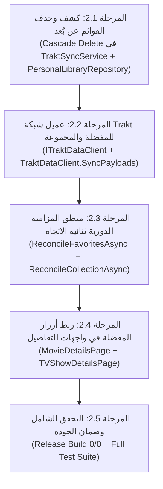

> [!NOTE]
> **Plan Status (`Intermediate U9 Design Record`)**: Historical follow-up design note; see [`/BUGS.md`](../../../BUGS.md) for current `[U9]` completion and remaining open gaps.

# وثيقة الخطة المعمارية التنفيذية: تكامل Trakt الشامل (المرحلة الثانية)
## كشف وحذف القوائم عن بُعد + ربط المفضلة المدمجة (Full Union) + رفع المكتبة لـ Trakt Collection

---

## 1. ملخص القرارات المعمارية المعتمدة (Decisions Baseline)
بناءً على جلسة التحليل والتمحيص المشتركة (/grill-me)، تم حسم القرارات الهندسية التالية:
1. **كشف وحذف القوائم عن بُعد**: الحذف من Trakt يُلغي القائمة المحلية فوراً وشاملاً (`Cascade Delete`) دون استثناء، مع مسح أي حركات معلقة لها في الطابور لمنع أي تناقضات.
2. **مزامنة المفضلة المدمجة (Native Favorites)**: اعتماد نمط **الاتحاد الثنائي المتكامل (Full Union)**؛ يتم سحب المفضلة من السيرفر وتطبيقها محلياً، مع رفع أي عناصر مفضلة محلياً إلى السيرفر ليتطابق الطرفان تماماً 1:1.
3. **نطاق المجموعات الإضافية**: تنفيذ ربط **المكتبة المحلية (Local Media Library)** بنقطة النهاية الرسمية `POST /sync/collection` لرفع ما يملكه المستخدم من أفلام ومسلسلات إلى حسابه السحابي.

---

## 2. المسار الهندسي المتتابع للتنفيذ (The Phased Roadmap)



---

## 3. تفاصيل التعديلات البرمجية الصريحة لكل مرحلة (Proposed Changes)

### المرحلة 2.1: كشف وحذف القوائم عن بُعد
#### [MODIFY] `src/TBDMovies.Infrastructure/Persistence/Repositories/PersonalLibraryRepository.cs`
- توفير دالة صريحة لحذف القائمة نهائياً مع حركاتها المعلقة:
  `DeleteCustomListCascade(long listId)` تحذف من `custom_lists` و `custom_list_members` و `custom_list_pending_actions`.

#### [MODIFY] `src/TBDMovies.Application/Trakt/TraktSyncService.cs`
- داخل `ReconcileCustomListsAsync`:
  ```csharp
  var remoteTraktIds = remoteLists.Select(l => l.TraktId).ToHashSet();
  var localLinkedLists = _personalLibraryRepository.ListCustomLists()
      .Where(l => l.TraktListId.HasValue && !l.IsDeleted)
      .ToList();

  foreach (var local in localLinkedLists)
  {
      if (!remoteTraktIds.Contains(local.TraktListId.Value))
      {
          // حُذفت سحابياً -> حذف محلي شامل فوري
          _personalLibraryRepository.DeleteCustomListCascade(local.Id);
      }
  }
  ```

---

### المرحلة 2.2: عميل شبكة Trakt للمفضلة والمكتبة (Data Client)
#### [MODIFY] `src/TBDMovies.Application/Trakt/ITraktDataClient.cs`
- إضافة العقود التالية:
  ```csharp
  // Favorites
  Task AddFavoriteMovieAsync(int tmdbId, string clientId, string accessToken, CancellationToken cancellationToken);
  Task RemoveFavoriteMovieAsync(int tmdbId, string clientId, string accessToken, CancellationToken cancellationToken);
  Task AddFavoriteShowAsync(int tmdbId, string clientId, string accessToken, CancellationToken cancellationToken);
  Task RemoveFavoriteShowAsync(int tmdbId, string clientId, string accessToken, CancellationToken cancellationToken);
  Task<IReadOnlyList<TraktFavoriteItem>> GetFavoriteMoviesAsync(string clientId, string accessToken, CancellationToken cancellationToken);
  Task<IReadOnlyList<TraktFavoriteItem>> GetFavoriteShowsAsync(string clientId, string accessToken, CancellationToken cancellationToken);

  // Collection
  Task AddToCollectionAsync(IReadOnlyList<int> movieTmdbIds, IReadOnlyList<int> showTmdbIds, string clientId, string accessToken, CancellationToken cancellationToken);
  Task<IReadOnlyList<TraktCollectionItem>> GetCollectionMoviesAsync(string clientId, string accessToken, CancellationToken cancellationToken);
  Task<IReadOnlyList<TraktCollectionItem>> GetCollectionShowsAsync(string clientId, string accessToken, CancellationToken cancellationToken);
  ```

#### [NEW] `src/TBDMovies.Infrastructure/Trakt/TraktDataClient.FavoritesAndCollection.cs`
- تنفيذ نقاط النهاية الرسمية:
  - `POST /sync/favorites` و `POST /sync/favorites/remove`
  - `GET /sync/favorites/movies` و `GET /sync/favorites/shows`
  - `POST /sync/collection` مع إرسال دفعات TMDB IDs.
  - `GET /sync/collection/movies` و `GET /sync/collection/shows`.

---

### المرحلة 2.3: منطق المزامنة الدورية ثنائية الاتجاه (Sync Logic)
#### [MODIFY] `src/TBDMovies.Application/Trakt/TraktSyncService.cs`
- إضافة خطوة `ReconcileFavoritesAsync`:
  1. جلب المفضلة من السيرفر وتطبيقها محلياً (`PersonalPreference.Liked` للأفلام، و `is_favorite = 1` للمسلسلات).
  2. جلب المفضلة المحلية التي تفتقر لتسجيل سحابي على Trakt ورفعها (Full Union).
- إضافة خطوة `ReconcileCollectionAsync`:
  1. جمع كافة أفلام ومسلسلات المكتبة المحلية ذات `tmdb_id > 0`.
  2. مقارنتها مع ما لدى السيرفر في `GET /sync/collection` ورفع غير الموجود عبر `POST /sync/collection`.

---

### المرحلة 2.4: ربط أزرار المفضلة في واجهات التفاصيل (UI Wiring)
#### [MODIFY] `src/TBDMovies.UI/Views/MovieDetailsPage.xaml.cs`
- داخل `WritePreference`: عند التبديل إلى `liked` أو إلغائه، إطلاق مهمة خلفية آمنة (Non-blocking) تدعو `AddFavoriteMovieAsync` أو `RemoveFavoriteMovieAsync` عندما يكون Trakt متصلاً.

#### [MODIFY] `src/TBDMovies.UI/Views/TVShowDetailsPage.xaml.cs`
- داخل `ToggleShowPersonal`: دعم `favorite == true` بإطلاق مهمة خلفية تستدعي `AddFavoriteShowAsync` أو `RemoveFavoriteShowAsync`.

---

### المرحلة 2.5: التحقق الشامل وضمان الجودة
1. **اختبارات الوحدة والتكامل**:
   - كتابة اختبارات كشف الحذف في `TraktListActionsTests.cs`.
   - كتابة اختبارات المفضلة والمجموعة في `TraktDataClientTests.cs`.
   - تشغيل حزمة الاختبارات بالكامل:
     ```powershell
     dotnet test "D:\TBD-Movies\TBDMovies_WinUI3\tests\TBDMovies.Tests\TBDMovies.Tests.csproj" -c Release
     ```
     **المعيار**: اجتياز **1,136+ اختباراً بنسبة 100% (صفر إخفاق)**.
2. **البناء بنمط Release**:
   - ```powershell
     dotnet build "D:\TBD-Movies\TBDMovies_WinUI3\TBDMovies.slnx" -c Release
     ```
     **المعيار**: 0 أخطاء و 0 تحذيرات (`0 Warning(s), 0 Error(s)`).
3. **التجربة الميدانية الحية**:
   - فحص تفاعل زر المفضلة وانعكاسه على السيرفر.
   - حذف قائمة من السيرفر والتأكد من اختفائها محلياً.
