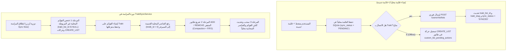

> [!WARNING]
> **Plan Status (`Partially Implemented — Open Sub-items in /BUGS.md`)**: Show-favorites bulk pull (`remoteFavShowTmdb`) and upload remain unimplemented in `TraktSyncService.cs:1934, 1963`. Authoritative status lives in [`/BUGS.md`](../../../BUGS.md).

# وثيقة الخطة المعمارية المقفولة: المزامنة التلقائية الشاملة ثنائية الاتجاه [U9] (Full Two-Way Auto-Sync)

---

## 1. ملخص الهدف والمعمارية (Goal Description)
بناءً على القرار المعتمد **(الخيار A — المزامنة التلقائية الشاملة ثنائية الاتجاه)**، سيتم إكمال الحلقة المفقودة في [U9] بحيث تصبح أي قائمة محلية (سواء أُنشئت حديثاً عبر `+ قائمة جديدة` أو كانت قائمة محلية قديمة مخزنة في SQLite بـ `trakt_list_id IS NULL`) قائمة سحابية متزامنة بالكامل على Trakt:
1. **إنشاء القائمة على السيرفر**: استدعاء نقطة النهاية الرسمية `POST /users/me/lists` عبر `TraktDataClient`.
2. **طابور العمليات غير المتصلة**: دعم حركة `CREATE_LIST` في جدول `custom_list_pending_actions` لتفريغها عند عودة الإنترنت إذا أُنشئت القائمة أوفلاين.
3. **الربط وتفريغ العناصر**: الحصول على `trakt_list_id` و `trakt_slug` وحفظهما في `custom_lists`، ثم رفع كافة عناصر القائمة المحلية التي تملك `tmdb_id > 0` إلى السيرفر.
4. **معالجة التعارض**: إذا وُجدت قائمة على السيرفر بنفس الاسم، تُضاف البادئة `[TBD] ` للقائمة المحلية وفق ميثاق [U9].

---

## 2. مخطط تدفق المزامنة الشاملة ثنائية الاتجاه (Two-Way Sync Flowchart)



---

## 3. التعديلات التفصيلية لكل ملف (Proposed Changes)

### 3.1. ترقية سكيما قاعدة البيانات (Infrastructure / Persistence)

#### [MODIFY] `DatabaseMigrator.cs`
- تعديل قيود جدول `custom_list_pending_actions` في Migration 22:
  - السماح لـ `media_kind` و `tmdb_id` بأن تكونا `NULL` حصراً عندما تكون `action_type = 'CREATE_LIST'`.
  - تحديث قيد التحقق `CHECK`:
    ```sql
    CREATE TABLE custom_list_pending_actions (
        id INTEGER PRIMARY KEY AUTOINCREMENT,
        list_id INTEGER NOT NULL REFERENCES custom_lists(id) ON DELETE CASCADE,
        media_kind TEXT CHECK(media_kind IS NULL OR media_kind IN ('MOVIE', 'SHOW')),
        tmdb_id INTEGER CHECK(tmdb_id IS NULL OR tmdb_id > 0),
        action_type TEXT NOT NULL CHECK(action_type IN ('ADD', 'REMOVE', 'CREATE_LIST')),
        created_at TEXT NOT NULL
    );
    ```

---

### 3.2. عميل وخدمات شبكة Trakt (Application / Trakt & Infrastructure / Trakt)

#### [MODIFY] `ITraktListWriter.cs`
- إضافة توقيع إنشاء القائمة:
  ```csharp
  Task<JsonElement> CreateCustomListAsync(
      string name,
      string? description,
      string privacy,
      string clientId,
      string accessToken,
      CancellationToken cancellationToken = default);
  ```

#### [MODIFY] `TraktDataClient.ListWriter.cs`
- تنفيذ `CreateCustomListAsync`:
  - إرسال `POST` إلى `users/me/lists`.
  - الحقول: `name`, `description`, `privacy = "private"`.
  - استخراج `ids.trakt` و `ids.slug` من الاستجابة بصيغة `JsonElement`.

---

### 3.3. مستودع القوائم الشخصية (Infrastructure / Repositories)

#### [MODIFY] `IRepositories.cs` & `PersonalLibraryRepository.cs`
- **تحديث `CreateCustomList`**:
  - عند إنشاء القائمة، يتم تعيين `sync_status = 'PENDING'`، وتسجيل حركة في طابور العمليات:
    `EnqueuePendingAction(id, null, null, "CREATE_LIST", now);`
- **تحديث `EnqueuePendingAction`**:
  - جعل المعاملات `CustomListMediaKind? kind` و `int? tmdbId` اختيارية لتقبل `null` عند تسجيل `CREATE_LIST`.
- **إضافة دوال الربط والاستعلام**:
  - `ListUnlinkedCustomLists()`: استرجاع القوائم التي تملك `trakt_list_id IS NULL AND is_deleted = 0`.
  - `LinkTraktCustomList(int listId, long traktListId, string traktSlug, DateTimeOffset now)`: تحديث الصف ببيانات Trakt وتغيير الحالة إلى `SYNCED`.
  - `ListLocalMembersWithTmdb(int listId)`: جلب كافة العناصر المحلية في القائمة التي تملك `tmdb_id > 0` لرفعها إلى Trakt عند المزامنة الأولى.

---

### 3.4. محرك المزامنة التلقائية (Application / Services)

#### [MODIFY] `TraktSyncService.cs` (`ReconcileCustomListsAsync`)
- **الخطوة الأولى (List Creation & Upward Sync)**:
  1. معالجة حركات `CREATE_LIST` في الطابور وأي قائمة في `ListUnlinkedCustomLists()`.
  2. استدعاء `_writer.CreateCustomListAsync(...)`.
  3. حفظ المعرفات الناتجة عبر `LinkTraktCustomList`.
  4. شطب حركة `CREATE_LIST` من جدول الانتظار.
  5. جلب كافة عناصر القائمة المحلية التي لها `tmdb_id > 0` ودفعها دفعة واحدة (Batch Push) إلى Trakt عبر `AddMovieToListAsync` و `AddShowToListAsync`.
- **الخطوة الثانية (Compaction & FIFO Item Replay)**:
  - تفريغ باقي حركات `ADD` و `REMOVE` بالترتيب الزمني بعد أن أصبحت كافة القوائم تمتلك `trakt_list_id` صالحاً.
- **الخطوة الثالثة (Downward Reconciliation)**:
  - جلب تحديثات Trakt وتحديث الكاش المحلي ومطابقة `last_synced_at`.

---

## 4. خطة التحقق والضمانات (Verification Plan)

### 4.1. الاختبارات الآلية (Automated Tests)
1. **اختبار ترقية السكيما**:
   - التحقق من قبول جدول `custom_list_pending_actions` لحركة `CREATE_LIST` مع قيم `NULL` لـ `media_kind` و `tmdb_id`.
2. **اختبار مزامنة القائمة المحلية إلى Trakt**:
   - إنشاء قائمة محلية جديدة ومحاكاة دورة المزامنة:
     - التأكد من استدعاء `CreateCustomListAsync`.
     - التأكد من ربط القائمة بـ `trakt_list_id` و `trakt_slug`.
     - التأكد من رفع المواد المحلية القديمة داخلها إلى Trakt.
3. **اختبار خلو البناء وتكامل الحزمة**:
   - تشغيل `dotnet build` والتأكد من `0 Warning(s), 0 Error(s)`.
   - تشغيل حزمة الاختبارات بالكامل والتأكد من اجتياز 1,131 / 1,131 اختباراً + الاختبارات الجديدة.

---

## 5. أسئلة المواءمة والتصميم النهائي (/grill-me)

> [!NOTE]
> هل توافق على اعتماد هذه الخطة لننطلق في التنفيذ الجراحي المتتابع فوراً؟
