> [!WARNING]
> **Plan Status (`Code Guard Implemented — Safeguard Unit Test Pending in /BUGS.md`)**: `if (!userListsSuccess)` guard is live at `TraktSyncService.cs:1666`, while its dedicated unit test remains open under `[U9]` in [`/BUGS.md`](../../../BUGS.md).

# خطة المعالجة الهندسية الشاملة (v2): إصلاح تحميل المكتبة وحماية مزامنة Trakt
## (Library Loading Resilience & Trakt Sync Hardening Plan — Final Approved Architecture)

> [!IMPORTANT]
> تم تحديث هذه الوثيقة إلى النسخة الثانية (v2) بعد استيعاب كافة نتائج وتوجيهات التدقيق المعماري الصارم للسمكة العدائية (`Hostile Design Critic Goldfish`). تعالج الخطة الآن جذرياً: ظاهرة قوائم الزومبي، وصمام أمان المسح العرضي للقوائم، ودورة حياة صفحة المكتبة، وتسريبات الذاكرة في كاش البطاقات، مع الحفاظ على الأداء الفوري (0ms) للواجهة.

---

## 1. التوصيف الدقيق للمشكلات المعمارية (Architectural Flaws & Root Causes)

### أ. صفحة المكتبة (`LibraryPage`)
1. **التصفير الانتحاري لكاش الأفلام (Line 722)**:
   في دالة `LoadMovies()` السطر 722:
   `if (_moviesRevision != AppServices.CatalogRevision) _movies = null;`
   يقوم بتدمير الكاش فوراً في نفس اللحظة التي تنطلق فيها مزامنة Trakt بالخلفية رافعةً `CatalogRevision`.
2. **فخ التعليق اللانهائي في حارس التحميل (Line 594)**:
   في دالة `Refresh()` السطر 594:
   `if (_showsLoading && (_movies is null || _movies.Count == 0))`
   يحجب شبكة العرض بالكامل ويظهر دائرة التحميل الدائمة (`LoadingPanel`).
3. **حلقة التكرار المفرغة وتجاهل نتائج المسلسلات (Line 769)**:
   في دالة `LoadShowsAsync()` السطر 769:
   `if (generation == _showsLoadGeneration && revision == AppServices.CatalogRevision)`
   يتجاهل نتائج قراءة المسلسلات إذا تغير `CatalogRevision`، مما يدفع الصفحة لإعادة تشغيل استعلام المسلسلات في حلقة مفرغة.
4. **ثغرة دورة حياة الصفحة في `Deactivate()` (Line 101-107)**:
   غياب `_isActivated = false;` في `Deactivate()` يجعل حارس `if (!_isActivated) return;` عديماً بعد أول زيارة، مما يسمح للعمليات الخلفية بتعديل عناصر الواجهة بعد مغادرتها.
5. **تسريب الذاكرة وتعارض كاش البطاقات (Line 655-668, 772)**:
   تفريغ `_showCards` دون تطهير واستدعاء `Dispose()` لقاموس `_cachedShowCards`، وتنفيذ الاستعلامات كـ `IEnumerable` مؤجل بدلاً من مصفوفة مادية مباشرة.
6. **التدهور الشامل غير المبرر عند تعثر المسلسلات (Line 748, 606)**:
   تحويل حالة الصفحة إلى `Error` وحجب الـ 90 فيلماً إذا حدث خطأ جزئي في جلب المسلسلات فقط.

### ب. خدمات المزامنة وتخزين القوائم (`TraktSyncService` & `PersonalLibraryRepository`)
1. **ثغرة إحياء قوائم الزومبي (Zombie Resurrection)**:
   استدعاء `DeleteCustomListCascade(del.Id)` محلياً حتى عند فشل إرسال أمر الحذف إلى Trakt (`DeleteCustomListAsync`)؛ مما يمسح شاهد القبر محلياً، فتعود القائمة للظهور مجدداً من Trakt في المزامنة التالية.
2. **تطهير شواهد القبور في `UpsertTraktCustomList`**:
   السطر `UPDATE custom_lists SET is_deleted = 0` يعيد إحياء القوائم المحذوفة محلياً.
3. **ثغرة تخطي القوائم المحذوفة محلياً (Tombstone Bypass)**:
   استعلام `ListCustomLists()` يفلتر `WHERE is_deleted = 0`، فلا ترجع القوائم الموسومة بـ `PENDING_DELETE`.
4. **خطر المسح الجماعي العرضي للقوائم (Catastrophic Remote Wipe)**:
   غياب تمرير علم نجاح جلب القوائم `userListsSuccess` إلى `ReconcileCustomListsAsync`، فإذا فشلت الشبكة أو فرغ الكاش، يتم مسح كافة قوائم المستخدم المحلية.
5. **سلامة المؤشرات الفارغة**:
   رمي `NullReferenceException` في `ITraktDataClient.AddCollectionBatchAsync`.

---

## 2. مصفوفة المقارنة الهندسية وحسم القرارات المعمارية (Decisions Matrix)

| المحور | الخيار المعتمد (Approved Option) | البدائل المرفوضة وسبب الرفض |
| :--- | :--- | :--- |
| **تزامن كاش المكتبة** | **المزامنة المتسامحة (Tolerant Snapshotting)**:<br>• اعتماد البيانات المقروءة للجيل الحالي فوراً.<br>• منع إفراغ الكاش تلقائياً.<br>• إبقاء عرض الأفلام حتى لو تعثرت المسلسلات. | • **التحميل المتزامن الكامل**: مرفوض لأنه يجمد واجهة المستخدم لعدة ثوانٍ.<br>• **إسقاط البيانات عند تغير المراجعة**: مرفوض لأنه يسبب فخ التحميل الأبدي. |
| **حماية شواهد القبور** | **الحذف المشروط بنجاح الشبكة (Guarded Cascade)**:<br>• لا يتم حذف شاهد القبر محلياً إلا بعد نجاح `DeleteCustomListAsync` أو إرجاع `404`.<br>• منع `UpsertTraktCustomList` من إحياء قوائم `PENDING_DELETE`. | • **الحذف الفوري غير المشروط**: مرفوض لأنه يولد قوائم الزومبي.<br>• **عدم الحذف المحلي أبداً**: مرفوض لأنه يراكم بيانات ميتة في قاعدة البيانات. |
| **صمام أمان كاش Trakt** | **صمام التحقق الثنائي (Two-Factor Safety Guard)**:<br>• اشتراط `userListsSuccess == true` صراحة من الدورة الحالية.<br>• اشتراط وجود كاش غير صفري وسليم لمقارنة الحذف عن بعد. | • **الاعتماد على الكاش القديم بدون علم النجاح**: مرفوض لأنه يهدد بمسح قوائم المستخدم عند انقطاع الاتصال. |
| **دورة حياة الصفحة والذاكرة** | **إغلاق الحراس والتحويل المادي الفوري**:<br>• تعيين `_isActivated = false` في `Deactivate`.<br>• تطهير واستدعاء `Dispose()` لـ `_cachedShowCards`.<br>• تحويل البطاقات فوراً إلى `.ToArray()`. | • **الترك كـ IEnumerable مؤجل**: مرفوض لأنه يكرر العمليات الجانبية وتسريب مراجع العرض. |

---

## 3. مخطط التدفق المعماري الشامل (Comprehensive Architecture Flowchart)

```mermaid
flowchart TD
    subgraph UI ["واجهة المكتبة التفاعلية (LibraryPage)"]
        A["فتح الصفحة (Activate)"] --> B["_isActivated = true"]
        B --> C["قراءة الأفلام فوراً (LoadMovies) دون تصفير الكاش"]
        C --> D["عرض الأفلام فوراً في MoviesGrid"]
        D --> E["إطلاق جلب المسلسلات خلفياً (LoadShowsAsync)"]
        E --> F["اكتمال استعلام المسلسلات بنجاح"]
        F --> G{"هل الجيل يطابق _showsLoadGeneration؟"}
        G -- "نعم" --> H["تطهير كاش المسلسلات القديم _cachedShowCards.Dispose()"]
        H --> I["تحديث _shows وتعيين _showsLoading = false"]
        I --> J{"هل الصفحة لا تزال نشطة (_isActivated)؟"}
        J -- "نعم" --> K["تحديث الشبكة Refresh الموحد دون وميض"]
        J -- "لا" --> L["تخطي التحديث المرئي بهدوء لحفظ الموارد"]
        G -- "لا" --> M["تجاهل الدفعة منتهية الصلاحية"]
    end

    subgraph TraktSync ["المزامنة الآمنة لقوائم Trakt (TraktSyncService)"]
        N["بدء ReconcileCustomListsAsync(accountId, userListsSuccess)"] --> O["استعلام ListDeletedCustomLists() لجلب شواهد القبور"]
        O --> P{"هل توجد قوائم محذوفة محلياً؟"}
        P -- "نعم" --> Q["إرسال DeleteCustomListAsync لكل قائمة"]
        Q --> R{"هل نجح الحذف أو أرجع 404؟"}
        R -- "نعم" --> S["تنفيذ الحذف المحلي النهائي DeleteCustomListCascade"]
        R -- "لا (خطأ شبكة)" --> T["الإبقاء على شاهد القبر للمحاولة القادمة"]
        P -- "لا" --> U{"فحص صمام الأمان: هل userListsSuccess == true؟"}
        U -- "لا" --> V["تخطي الحذف عن بعد بالكامل (حماية من المسح الجماعي)"]
        U -- "نعم" --> W["مقارنة القوائم وحذف ما اختفى من Trakt فقط بأمان"]
    end
```



---

## 4. قائمة التعديلات الجراحية المحددة لكل ملف (Surgical Code Changes)

### 1. طبقة البيانات (`Domain` & `Infrastructure`)

#### [MODIFY] `TBDMovies.Application/Repositories/IRepositories.cs`
- إضافة العقد الصريح لشواهد القبور:
  ```csharp
  IReadOnlyList<CustomListRecord> ListDeletedCustomLists() => [];
  ```

#### [MODIFY] `TBDMovies.Infrastructure/Persistence/Repositories/PersonalLibraryRepository.cs`
- **تنفيذ دالة `ListDeletedCustomLists()`**:
  ```csharp
  public IReadOnlyList<CustomListRecord> ListDeletedCustomLists()
  {
      using var connection = SqliteConnections.Open(_connectionString);
      using var command = Command(connection, null, """
          SELECT cl.id, cl.display_name, COUNT(m.id), cl.trakt_list_id, cl.trakt_slug, cl.sync_status, cl.last_synced_at
            FROM custom_lists cl
            LEFT JOIN custom_list_members m ON m.list_id = cl.id
           WHERE cl.is_deleted = 1
           GROUP BY cl.id, cl.display_name, cl.created_at, cl.trakt_list_id, cl.trakt_slug, cl.sync_status, cl.last_synced_at
           ORDER BY cl.created_at, cl.id;
          """);
      var result = new List<CustomListRecord>();
      using var reader = command.ExecuteReader();
      while (reader.Read())
      {
          result.Add(new CustomListRecord(
              reader.GetInt32(0),
              reader.GetString(1),
              reader.GetInt32(2),
              reader.IsDBNull(3) ? null : reader.GetInt64(3),
              reader.IsDBNull(4) ? null : reader.GetString(4),
              reader.IsDBNull(5) ? "SYNCED" : reader.GetString(5),
              reader.IsDBNull(6) ? null : reader.GetString(6)));
      }
      return result;
  }
  ```
- **حماية `UpsertTraktCustomList` من إحياء شواهد القبور**:
  تعديل جملة الـ UPDATE بحيث لا تقلب `is_deleted = 0` إذا كانت القائمة تحمل `sync_status = 'PENDING_DELETE'`.

---

### 2. طبقة المزامنة مع Trakt (`Application`)

#### [MODIFY] `TBDMovies.Application/Trakt/ITraktDataClient.cs`
- **إصلاح أمان المؤشرات الفارغة (السطر 104)**:
  ```csharp
  Task<TraktSyncWriteResult> AddCollectionBatchAsync(
      IReadOnlyList<long>? movieTmdbIds,
      IReadOnlyList<long>? showTmdbIds,
      string token,
      CancellationToken ct = default) =>
      Task.FromResult(new TraktSyncWriteResult(true, (movieTmdbIds?.Count ?? 0) + (showTmdbIds?.Count ?? 0)));
  ```

#### [MODIFY] `TBDMovies.Application/Trakt/TraktSyncService.cs`
- **تحديث توقيع `ReconcileCustomListsAsync`**:
  تمرير علم `bool userListsSuccess` من السطر 609:
  ```csharp
  await ReconcileCustomListsAsync(uuid, userListsSuccess, opToken).ConfigureAwait(false);
  ```
- **معالجة شواهد القبور وحظر الزومبي**:
  استخدام `_personalLibraryRepository.ListDeletedCustomLists()`.
  استدعاء `DeleteCustomListCascade(del.Id)` فقط إذا نجح `DeleteCustomListAsync` أو رمى خطأ `404 Not Found`.
- **تفعيل صمام الأمان الثنائي ضد المسح العرضي**:
  عدم تنفيذ مسار المقارنة والحذف عن بعد إذا كانت `!userListsSuccess` أو كان كاش `TraktCacheResourceKeys.Lists` فارغاً أو يحمل خطأ.
- **استكمال مزامنة مفضلة المسلسلات**:
  ربط `_showPersonalRepository` لتحديث مفضلة المسلسلات ثنائياً أو تنظيف الكود المعلق.

---

### 3. طبقة الواجهة الرسومية (`UI`)

#### [MODIFY] `TBDMovies.UI/Views/LibraryPage.xaml.cs`
- **دورة الحياة**:
  - في `Deactivate()`: إضافة `_isActivated = false;`.
  - في `Activate()`: الاشتراك السليم في تحديثات المراجعة.
- **إصلاح `LoadMovies()`**:
  - حذف سطر التدمير الذاتي للكاش:
    `if (_moviesRevision != AppServices.CatalogRevision) _movies = null;` (محذوف تماماً).
  - تثبيت `_moviesRevision = revision;`.
- **إصلاح `LoadShowsAsync()`**:
  - اعتماد النتائج المقروءة فوراً إذا كان `generation == _showsLoadGeneration` وتحديث `_showsRevision = revision;`.
  - تطهير واستدعاء `Dispose()` لبطاقات المسلسلات القديمة:
    ```csharp
    foreach (var card in _cachedShowCards.Values) card.Dispose();
    _cachedShowCards.Clear();
    ```
  - عند انتهاء الدالة، التحقق من `if (!_isActivated) return;` قبل استدعاء `Refresh()`.
- **عزل أخطاء المسلسلات عن الأفلام**:
  إذا تعثر جلب المسلسلات وحدها، لا يتم تعيين `_state = LibraryViewState.Error` إذا كانت قائمة الأفلام معروضة بنجاح، ويستمر المستخدم في تصفح أفلامه بسلاسة.
- **التحويل المادي الفوري في `PopulateLibrary()`**:
  تحويل بطاقات الأفلام والمسلسلات مباشرة عبر `.ToArray()` قبل أي عمليات ترتيب أو تصفية لمنع إعادة تنفيذ التوقيعات وتسريب الذاكرة.

---

## 5. بروتوكول التحقق الصارم والإثباتات (Verification Protocol)

1. **البناء الآلي بوضع Release**:
   ```powershell
   dotnet build "D:\TBD-Movies\TBDMovies_WinUI3\TBDMovies.slnx" -c Release
   ```
   **المعيار**: 0 أخطاء و 0 تحذيرات قطعية (`0 Warning(s), 0 Error(s)`).
2. **حزمة الاختبارات الشاملة**:
   ```powershell
   dotnet test "D:\TBD-Movies\TBDMovies_WinUI3\TBDMovies.slnx" -c Release
   ```
   **المعيار**: اجتياز 100% من الاختبارات (1,141+ اختبار).
3. **اختبارات وحدة جديدة متخصصة**:
   - اختبار `ListDeletedCustomLists` للتأكد من استرجاع القوائم الموسومة للحذف فقط.
   - اختبار صمام أمان كاش Trakt عند تعطل الشبكة (`userListsSuccess = false`) والتأكد من عدم مسح أي قائمة محلية.
   - اختبار حظر قوائم الزومبي والتأكد من بقاء شاهد القبر عند فشل الاتصال.
4. **التحقق الميداني الحي (Interactive UI Verification)**:
   - فتح نسخة الـ Release للتطبيق والتأكد من ظهور الـ 90 فيلماً والـ 16 مسلسلاً فوراً دون أي تعليق أو وميض.
   - فحص التنقل بين تبويب الأفلام وتبويب المسلسلات دون ظهور الـ Spinner المستمر.
   - تجربة حذف قائمة محلية أثناء انقطاع الاتصال والتأكد من عدم إحيائها كقائمة زومبي.
