> [!IMPORTANT]
> **Plan Status (`Implemented in Migration 22 — Schema Updated in Migration 23`)**: Note that the `NOT NULL` constraint on `media_kind` and `tmdb_id` in `custom_list_pending_actions` shown here was subsequently relaxed in [`u9_migration_23_plan.md`](u9_migration_23_plan.md). Authoritative `[U9]` status lives in [`/BUGS.md`](../../../BUGS.md).

# وثيقة التصميم المعماري لمهمة [U9] — توحيد قوائم Trakt مع القوائم المحلية (النسخة 5 المعتمدة)

---

## 1. القرارات المعمارية السبعة (Architectural Decisions)

### القرار 1: سكيما البيانات الحقيقية ودعم الوسائط السحابية (Schema Alignment & Nullable tmdb_id)
- **فحص الكود الفعلي**:
  - جداول `movies` و `tv_shows` في قاعدة البيانات الحالية لا تحتوي على عمود باسم `tmdb_id`؛ بل تعتمد على عمودين نصيين هما `provider TEXT` و `external_id TEXT`.
  - بعض المواد المحلية قد تكون غير مطابقة بعد (MetadataStatus = Pending/NeedsMatch) أو ترتبط بمزودات أخرى، وبالتالي فإن فرض `tmdb_id NOT NULL` أو `CHECK (tmdb_id > 0)` على كافة السجلات سيؤدي إلى فشل الهجرة وانهيار قاعدة البيانات فوراً عند مصادفة أي مادة محلية غير معرفة على TMDB.
- **الحل المعتمد في Migration 22**:
  - إضافة عمود `tmdb_id INTEGER DEFAULT NULL` إلى جدول `custom_list_members`.
  - السماح لـ `tmdb_id` بأن يكون `NULL` للمواد المحلية غير المطابقة، مع فرضه إجبارياً وأكبر من الصفر حصراً للمواد السحابية القادمة من Trakt والتي ليس لها ملف محلي.
  - استخراج المعرف بأمان تام أثناء الهجرة باستخدام الفحص الشرطي للقيم الرقمية:
    ```sql
    CASE 
        WHEN clm.media_kind = 'MOVIE' AND m.provider = 'tmdb' AND m.external_id GLOB '[0-9]*' 
            THEN CAST(m.external_id AS INTEGER)
        WHEN clm.media_kind = 'SHOW' AND s.provider = 'tmdb' AND s.external_id GLOB '[0-9]*' 
            THEN CAST(s.external_id AS INTEGER)
        ELSE NULL 
    END AS tmdb_id
    ```
  - **شرط الـ `CHECK` الصارم والمحمي**:
    ```sql
    CHECK (
        (media_kind IN ('MOVIE', 'SHOW')) AND
        (
            -- حالة 1: مادة محلية من المكتبة (فيلم محلي)
            (media_kind = 'MOVIE' AND movie_id IS NOT NULL AND show_id IS NULL) OR
            -- حالة 2: مادة محلية من المكتبة (مسلسل محلي)
            (media_kind = 'SHOW' AND show_id IS NOT NULL AND movie_id IS NULL) OR
            -- حالة 3: مادة سحابية فقط من Trakt (لا يوجد ملف محلي، ويشترط وجود tmdb_id صالح)
            (movie_id IS NULL AND show_id IS NULL AND tmdb_id IS NOT NULL AND tmdb_id > 0)
        )
    )
    ```
  - **فهارس منع التكرار (Unique Constraints)**:
    - الإبقاء على الفهارس الجزئية المحلية لمنع تكرار المادة المحلية:
      ```sql
      CREATE UNIQUE INDEX ux_custom_list_members_movie 
          ON custom_list_members(list_id, movie_id) WHERE movie_id IS NOT NULL;
      CREATE UNIQUE INDEX ux_custom_list_members_show 
          ON custom_list_members(list_id, show_id) WHERE show_id IS NOT NULL;
      ```
    - إضافة فهرس جزئي لمنع تكرار المادة السحابية داخل القائمة نفسها:
      ```sql
      CREATE UNIQUE INDEX ux_custom_list_members_tmdb 
          ON custom_list_members(list_id, media_kind, tmdb_id) WHERE tmdb_id IS NOT NULL;
      ```

---

### القرار 2: طابور العمليات غير المتصلة والترتيب الزمني (Offline Queue: Compaction & FIFO)
- **المعضلة**: إعادة إحياء المواد المحذوفة (Zombie Resurrection) في حال تعديل القائمة أثناء انقطاع الاتصال، وخطر عكس الترتيب الزمني إذا نُفذ الحذف قبل الإضافة عشوائياً.
- **الحل المعتمد**:
  - إنشاء جدول `custom_list_pending_actions`:
    ```sql
    CREATE TABLE custom_list_pending_actions (
        id INTEGER PRIMARY KEY AUTOINCREMENT,
        list_id INTEGER NOT NULL REFERENCES custom_lists(id) ON DELETE CASCADE,
        media_kind TEXT NOT NULL CHECK(media_kind IN ('MOVIE', 'SHOW')),
        tmdb_id INTEGER NOT NULL CHECK(tmdb_id > 0),
        action_type TEXT NOT NULL CHECK(action_type IN ('ADD', 'REMOVE')),
        created_at TEXT NOT NULL
    );
    CREATE INDEX idx_pending_actions_list ON custom_list_pending_actions(list_id);
    ```
  - **خوارزمية التفريغ**:
    1. **الإلغاء المسبق في الذاكرة (In-Memory Compaction)**: فحص السجلات لنفس المادة `(list_id, media_kind, tmdb_id)`. إذا وُجد أمر `ADD` تبعه `REMOVE` أثناء نفس فترة عدم الاتصال، يتم شطب العمليتين فوراً (`No-Op`) من الطابور دون مخاطبة السيرفر.
    2. **التنفيذ الزمني الصارم (Chronological FIFO Replay)**: تفريغ العمليات المتبقية وفق ترتيب تسجيلها الفعلي: `ORDER BY created_at ASC`.
    3. **المسح والتحديث**: شطب كل عملية بعد نجاح إرسالها إلى Trakt API، ثم سحب قائمة التحديثات ومطابقة `updated_at`.

---

### القرار 3: معالجة تكرار أسماء القوائم (Name Disambiguation)
- لمنع استثناء `DuplicateCustomListNameException` الناتج عن قاعدة التحقق البرمجية `PersonalLibraryRepository.RequireUniqueName`:
  - عند مزامنة قائمة من Trakt تحمل نفس اسم قائمة محلية قائمة بالفعل:
    - تحتفظ قائمة Trakt بالاسم الأصلي في حقل `display_name` بجدول `custom_lists`.
    - تُعدل القائمة المحلية وتُحفظ صراحة في قاعدة البيانات بإضافة البادئة: `display_name = '[TBD] ' || display_name`.
  - هذا الإجراء يلبي متطلب تفرد الأسماء ويمنع تصادم القيود.

---

### القرار 4: سلامة أقفال قاعدة البيانات (Database Lock Safety) والمزامنة الشرطية
- **فصل الشبكة عن أقفال الكتابة**:
  - في نظام SQLite WAL Mode، تخضع الكتابة لبوابة واحدة `DatabaseWriteGate`.
  - **قاعدة صارمة**: يُحظر تماماً إجراء اتصالات الشبكة بـ Trakt API داخل نطاق `DatabaseWriteGate` أو `SqliteTransaction`.
  - تُجرى كافة اتصالات الشبكة ومعالجة البيانات في الذاكرة عبر مهام الخلفية (`Task.Run`).
  - تُفتح بوابة الكتابة حصراً لتنفيذ المعاملة الدفعية (Batch Transaction) بزمن تنفيذ يتراوح بين 5 إلى 15ms ثم تحرير القفل مباشرة.
- **المزامنة الشرطية (Conditional Sync)**:
  - مقارنة طابع `remote.updated_at` مع `local.last_synced_at`. إذا تماثل الطابعان، يتم تخطي استدعاء نقطة النهاية `/items` لتوفير استهلاك المعالج والشبكة.

---

### القرار 5: حسم تعارض الحذف على مستوى القائمة (Tombstone Always Wins)
- في حال حذف قائمة محلياً في وضع عدم الاتصال، يُسجل حقل `is_deleted = 1` كعلامة حذف (Tombstone).
- نية الحذف تلغي أي تعديلات تمت على السيرفر؛ وفور استعادة الاتصال، يُرسل التطبيق أمر `DELETE /users/me/lists/{id}` لحذف القائمة نهائياً من السيرفر ومن قاعدة البيانات المحلية.

---

### القرار 6: شريط التبويبات الموحد وعناصر رأس الصفحة (Unified Tab Strip & Pure Text Pills)
- **إزالة الحاويات المنفصلة**:
  - إزالة حاوية `TraktRow` بالكامل من واجهة `MyListsPage.xaml`.
  - دمج كافة القوائم (قوائم النظام الأساسية، قوائم المستخدم المحلية، وقوائم Trakt) في شريط كبسولات موحد واحد (`controls:WrapPanel`).
- **كبسولات نصية نقية بدون أيقونات (No Icons in Tab Pills)**:
  - بناءً على القرار المعتمد، تكون أزرار التبويبات نصية صافية تماماً خالية من أي أيقونات أو رموز تعبيرية.
  - يظهر نص التبويب متبوعاً بعداد العناصر، مثل: `المفضلة (12)`، `أفلام السهرة (8)`، `[TBD] المفضلة (3)`.
  - العلامة المميزة الوحيدة للقوائم المحلية المكررة هي البادئة النصية `[TBD]`.
- **عناصر رأس الصفحة (Page Header Controls)**:
  - إضافة مؤشر نصي لحالة المزامنة: `SyncStatusText` (مثال: "تمت المزامنة" أو "آخر مزامنة: منذ دقيقتين").
  - إضافة زر مزامنة يدوي فوري: `SyncNowButton` بأيقونة المزامنة القياسية `&#xE895;` لتشغيل المزامنة عند الطلب.

---

### القرار 7: دورة المزامنة الخفيفة وحماية TMDB (3-Minute Cadence & Zero TMDB Throttling)
- **الفاصل الزمني**: ضبط عتبة الحداثة على **3 دقائق (180 ثانية)**. عند فتح التطبيق أو الانتقال إلى صفحة القوائم، إذا تجاوزت المدة 3 دقائق تُطلق مزامنة خفيفة في الخلفية.
- **حماية TMDB واستبعاد طلبات الصور**:
  - Trakt API لا يوفر روابط صور في استجابات المزامنة.
  - تُمنع مخاطبة TMDB API نهائياً أثناء المزامنة الدورية السريعة لضمان إتمامها في بضع مئات من المللي ثانية دون تجاوز حدود الاستخدام (Rate Limits).
  - تُحمل بوسترات المواد السحابية غير المتوفرة محلياً بشكل كسول (Lazy Loading On-Demand) فقط عند دخول الكرت في مجال رؤية المستخدم (Viewport) عبر كاش الصور المحلي أو خدمة الصور المستقلة.

---

## 2. المواصفات البصرية للواجهة وسلوك الكروت (UI Specification)

### 2.1. تخطيط رأس الصفحة وشريط التبويبات الموحد
```
┌────────────────────────────────────────────────────────────────────────────────────────────────────────┐
│  قوائمي  (7 قوائم)    [تمت المزامنة]  [🔄]                                       [🔍 بحث...]  [+ قائمة جديدة] │
├────────────────────────────────────────────────────────────────────────────────────────────────────────┤
│  [المفضلة (12)]   [المشاهدة لاحقاً (5)]   [متابعة المشاهدة (3)]   [سجل المشاهدة (45)]                  │
│  [أفلام السهرة (8)]   [أفضل أعمال نولان (14)]   [[TBD] المفضلة (2)]                                      │
└────────────────────────────────────────────────────────────────────────────────────────────────────────┘
```

#### هيكل XAML في `MyListsPage.xaml`:
```xml
<!-- رأس الصفحة: العنوان + حالة المزامنة + زر المزامنة الفورية + البحث + قائمة جديدة -->
<Grid ColumnSpacing="16" VerticalAlignment="Center">
    <Grid.ColumnDefinitions>
        <ColumnDefinition Width="*" />
        <ColumnDefinition Width="Auto" />
    </Grid.ColumnDefinitions>

    <StackPanel Grid.Column="0" Orientation="Horizontal" Spacing="12" VerticalAlignment="Center">
        <TextBlock x:Name="PageTitleText" Style="{StaticResource TitleTextBlockStyle}" Text="قوائمي" />
        <TextBlock x:Name="ListsCountText" Style="{StaticResource SecondaryCaptionTextStyle}" VerticalAlignment="Bottom" Margin="0,0,0,4" />
        
        <!-- حالة المزامنة وزر التحديث اليدوي -->
        <StackPanel Orientation="Horizontal" Spacing="6" VerticalAlignment="Center">
            <TextBlock x:Name="SyncStatusText" Style="{StaticResource CaptionTextBlockStyle}" Text="تمت المزامنة" />
            <Button x:Name="SyncNowButton" Click="SyncNowButton_Click" Style="{StaticResource SubtleButtonStyle}" Padding="4" ToolTipService.ToolTip="مزامنة فورية مع Trakt">
                <FontIcon x:Name="SyncIcon" FontFamily="{StaticResource SymbolThemeFontFamily}" FontSize="12" Glyph="&#xE895;" />
            </Button>
        </StackPanel>
    </StackPanel>

    <StackPanel Grid.Column="1" Orientation="Horizontal" Spacing="12" VerticalAlignment="Center">
        <AutoSuggestBox x:Name="SearchBox" Width="240" QueryIcon="Find" CornerRadius="8" Style="{StaticResource PageSearchBoxStyle}" />
        <Button x:Name="NewListButton" Click="NewListButton_Click" Style="{StaticResource AccentControlButtonStyle}" CornerRadius="8" Height="32">
            <StackPanel Orientation="Horizontal" Spacing="6">
                <FontIcon FontFamily="{StaticResource SymbolThemeFontFamily}" FontSize="12" Glyph="&#xE710;" />
                <TextBlock x:Name="NewListButtonText" Text="قائمة جديدة" />
            </StackPanel>
        </Button>
    </StackPanel>
</Grid>

<!-- شريط الكبسولات الموحد: نصوص صافية تماماً بدون أيقونات داخل الأزرار -->
<controls:WrapPanel x:Name="ListSelector" Orientation="Horizontal" ColumnSpacing="6" RowSpacing="8" HorizontalAlignment="Stretch">
    <!-- تبويبات النظام وتبويبات القوائم المخصصة تُعرض بنفس الستايل TabPillItemStyle بدون FontIcon -->
</controls:WrapPanel>
```

---

### 2.2. مواصفات كرت المادة السحابية (Cloud Media Card)
- **تعريف المادة السحابية**: مادة مسجلة في القائمة بـ `movie_id IS NULL AND show_id IS NULL` ولديها `tmdb_id > 0`.
- **المظهر البصري**:
  - عرض شارة نصية صغيرة على الكرت: `[سحابي]` للدلالة على عدم وجود ملف محلي.
  - إظهار العنوان والسنة المسترجعين من كاش Trakt.
  - تحميل البوستر كسولاً عند الطلب من الكاش أو TMDB.
- **قائمة السياق المعتمدة (Context Menu — خالية من أي ميزات خارج النطاق)**:
  - `عرض التفاصيل (View Details)`: فتح صفحة التفاصيل لعرض ميتاداتا العمل.
  - `إزالة من القائمة (Remove from List)`: حذف المادة من القائمة المحددة ومزامنة الحذف.
  - (استبعاد خيارات التشغيل لعدم وجود ملف محلي، واستبعاد أي أدوات جلب روابط خارجية لكونها خارج نطاق المهمة).

---

## 3. ترقية قاعدة البيانات الشاملة (`DatabaseMigrator.cs` — Migration 22)

```csharp
// Migration 22: Unified Trakt Custom Lists, Cloud Items support, and Offline Actions Queue
@"
    -- 1. إضافة أعمدة مزامنة القوائم
    ALTER TABLE custom_lists ADD COLUMN trakt_list_id INTEGER DEFAULT NULL;
    ALTER TABLE custom_lists ADD COLUMN trakt_slug TEXT DEFAULT NULL;
    ALTER TABLE custom_lists ADD COLUMN sync_status TEXT NOT NULL DEFAULT 'SYNCED';
    ALTER TABLE custom_lists ADD COLUMN is_deleted INTEGER NOT NULL DEFAULT 0;
    ALTER TABLE custom_lists ADD COLUMN last_synced_at TEXT DEFAULT NULL;
    CREATE INDEX idx_custom_lists_trakt ON custom_lists(trakt_list_id);

    -- 2. ترقية جدول الأعضاء مع دعم tmdb_id الاختياري وحماية السجلات غير المطابقة
    PRAGMA foreign_keys = OFF;
    CREATE TABLE custom_list_members_new (
        id INTEGER PRIMARY KEY,
        list_id INTEGER NOT NULL REFERENCES custom_lists(id) ON DELETE CASCADE,
        media_kind TEXT NOT NULL CHECK(media_kind IN ('MOVIE', 'SHOW')),
        tmdb_id INTEGER DEFAULT NULL,
        movie_id INTEGER REFERENCES movies(id) ON DELETE CASCADE,
        show_id INTEGER REFERENCES tv_shows(id) ON DELETE CASCADE,
        added_at TEXT NOT NULL,
        CHECK (
            (media_kind IN ('MOVIE', 'SHOW')) AND
            (
                (media_kind = 'MOVIE' AND movie_id IS NOT NULL AND show_id IS NULL) OR
                (media_kind = 'SHOW' AND show_id IS NOT NULL AND movie_id IS NULL) OR
                (movie_id IS NULL AND show_id IS NULL AND tmdb_id IS NOT NULL AND tmdb_id > 0)
            )
        )
    );

    -- نقل البيانات بأمان مع استخراج tmdb_id من provider و external_id دون افتراض وجود أعمدة وهمية
    INSERT INTO custom_list_members_new (id, list_id, media_kind, tmdb_id, movie_id, show_id, added_at)
    SELECT clm.id, clm.list_id, clm.media_kind,
           CASE 
               WHEN clm.media_kind = 'MOVIE' AND m.provider = 'tmdb' AND m.external_id GLOB '[0-9]*' 
                   THEN CAST(m.external_id AS INTEGER)
               WHEN clm.media_kind = 'SHOW' AND s.provider = 'tmdb' AND s.external_id GLOB '[0-9]*' 
                   THEN CAST(s.external_id AS INTEGER)
               ELSE NULL 
           END,
           clm.movie_id, clm.show_id, clm.added_at
      FROM custom_list_members clm
      LEFT JOIN movies m ON m.id = clm.movie_id
      LEFT JOIN tv_shows s ON s.id = clm.show_id;

    DROP TABLE custom_list_members;
    ALTER TABLE custom_list_members_new RENAME TO custom_list_members;

    CREATE INDEX idx_custom_list_members_list ON custom_list_members(list_id);
    CREATE UNIQUE INDEX ux_custom_list_members_movie 
        ON custom_list_members(list_id, movie_id) WHERE movie_id IS NOT NULL;
    CREATE UNIQUE INDEX ux_custom_list_members_show 
        ON custom_list_members(list_id, show_id) WHERE show_id IS NOT NULL;
    CREATE UNIQUE INDEX ux_custom_list_members_tmdb 
        ON custom_list_members(list_id, media_kind, tmdb_id) WHERE tmdb_id IS NOT NULL;
    PRAGMA foreign_keys = ON;

    -- 3. إنشاء جدول طابور العمليات غير المتصلة
    CREATE TABLE custom_list_pending_actions (
        id INTEGER PRIMARY KEY AUTOINCREMENT,
        list_id INTEGER NOT NULL REFERENCES custom_lists(id) ON DELETE CASCADE,
        media_kind TEXT NOT NULL CHECK(media_kind IN ('MOVIE', 'SHOW')),
        tmdb_id INTEGER NOT NULL CHECK(tmdb_id > 0),
        action_type TEXT NOT NULL CHECK(action_type IN ('ADD', 'REMOVE')),
        created_at TEXT NOT NULL
    );
    CREATE INDEX idx_pending_actions_list ON custom_list_pending_actions(list_id);
"
```

---

## 4. مخطط التدفق الشامل للمزامنة (Sync Workflow Flowchart)

```mermaid
flowchart TD
    subgraph Fast_Sync["المزامنة السريعة (3 دقائق)"]
        S1["فتح التطبيق أو الدخول لصفحة القوائم"] --> S2["تحميل فوري من SQLite المحلي (0ms)"]
        S2 --> S3{"هل انقضى > 3 دقائق أو توجد عمليات معلقة؟"}
        S3 -- "نعم" --> S4["جلب ميتاداتا قوائم Trakt في الخلفية (صفر طلبات لـ TMDB)"]
        S3 -- "لا" --> S5["تخطي المزامنة"]
    end

    subgraph Offline_Actions["العمليات غير المتصلة"]
        A1["إضافة أو حذف مادة في وضع عدم الاتصال"] --> A2["تحديث واجهة المستخدم فوراً (0ms)"]
        A2 --> A3["تحديث SQLite المحلي"]
        A3 --> B1{"هل الاتصال متاح؟"}
        B1 -- "لا" --> B2["تسجيل العملية في custom_list_pending_actions"]
        B1 -- "نعم" --> B3["إرسال مباشر إلى Trakt API"]
    end

    subgraph Queue_Drain["تفريغ الطابور عند عودة الاتصال"]
        C1["عودة الاتصال أو الضغط على مزامنة الآن"] --> C2["فحص العمليات المعلقة"]
        C2 --> C3["الإلغاء المسبق في الذاكرة: إسقاط عمليات ADD + REMOVE المتبادلة لنفس المادة"]
        C3 --> C4["تفريغ باقي العمليات بالترتيب الزمني: ORDER BY created_at ASC"]
        C4 --> C5["شطب العمليات المكتملة من الطابور"]
        C5 --> C6["سحب التحديثات وتحديث كاش SQLite عبر Batch Transaction"]
    end
```



---

## 5. بروتوكول التحقق والاختبار (Verification Protocol)

1. **سلامة هجرة قاعدة البيانات (Migration 22)**:
   - التأكد من نجاح الهجرة دون أخطاء في وجود مواد محلية تفتقر لـ `tmdb_id` أو تحوي قيماً نصية غير رقمية.
2. **صحة تفريغ طابور العمليات (Compaction & FIFO)**:
   - محاكاة إضافة مادة ثم حذفها في وضع عدم الاتصال والتأكد من إلغائهما المسبق قبل إرسال أي طلب شبكي.
   - محاكاة حذف مادة قديمة وإضافة مادة جديدة والتأكد من التنفيذ بالترتيب الزمني الفعلي.
3. **تفرد الأسماء ومعالجة التكرار**:
   - اختبار وجود قائمة محلية بنفس اسم قائمة Trakt والتحقق من حفظ المحلية ببادئة `[TBD]` في قاعدة البيانات.
4. **عزل أقفال قاعدة البيانات**:
   - التحقق من تنفيذ كافة طلبات الشبكة خارج بوابة الكتابة `DatabaseWriteGate` مع استقرار زمن الحفظ الدفعي عند 5-15ms.
5. **سلامة البناء وحزمة الاختبارات**:
   - بناء الحل البرمجي بالكامل بخلو تام من التحذيرات والأخطاء (`0 Warning(s), 0 Error(s)`).
   - اجتياز 100% من حزمة الاختبارات الحالية البالغة **1,126 اختباراً** دون أي إخفاق.
